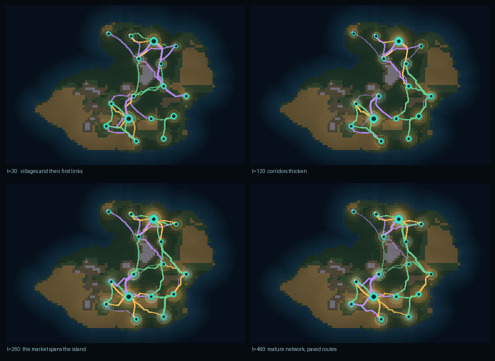

# ASEOWS — Emergent Spatial‑Economic Open‑World Simulator

A self‑contained 2D agent‑based world where **nobody plans the economy**.
Sixteen autonomous settlements sit on a procedurally generated island, each
endowed with whatever its terrain gives it. Every few ticks a settlement looks
around its own horizon for a neighbour that is short of something it has spare.
Links are scored with a **spatial gravity kernel**, traded only when the price
premium beats the freight bill, and paved into roads once enough cargo has worn
the route in. Nothing in the loop assigns partners, sets prices, or routes
goods — those are all outputs.

The project is also a **build pipeline**: a LangGraph state machine
(`Planner → Spatial‑Economic Model Synthesizer → Sandbox Visual Tester →
Self‑Correction`) compiles the world, measures it against eight gates, and
repairs its own mis‑tuning before signing off. The loop starts from a
deliberately parsimonious hypothesis, discovers it is too tight, and widens it:

```
[planner]      world 96x64 seed 20261101 -> 16 sites, land 42.55%, critical radius 9.85
[synthesizer]  attempt 0: compiled spec (radius=9.85, partners=8, growth=0.0160)
[tester]       attempt 0: FAIL (7/8 gates) failing=['N-COMP']
[reflector]    attempt 0 failed as network_fragmentation -> 3 patches
[synthesizer]  attempt 1: compiled spec (radius=17.73, partners=10)
[tester]       attempt 1: PASS (8/8 gates)
[finalizer]    verdict PASS_WITH_RETRIES after 2 attempt(s)
```



---

## Contents

1. [What you are looking at](#what-you-are-looking-at)
2. [Quickstart](#quickstart)
3. [The interactive console](#the-interactive-console)
4. [The model, mathematically](#the-model-mathematically)
5. [The build pipeline](#the-build-pipeline)
6. [Gates: what "correct" means here](#gates-what-correct-means-here)
7. [Self‑correction and the fault matrix](#self-correction-and-the-fault-matrix)
8. [HTTP API](#http-api)
9. [Tests](#tests)
10. [Repository layout](#repository-layout)
11. [Design notes, audit findings and limitations](#design-notes-audit-findings-and-limitations)

---

## What you are looking at

| Mechanic | Where it lives | What it does |
|---|---|---|
| Procedural island | `agora/world.py` | fractal value noise → elevation/moisture → 7 biomes, resource provinces, greedy farthest‑point siting |
| Territorial endowments | `world.territorial_yield` | each settlement's production capacity, from the terrain under its radius |
| Cobb‑Douglas production | `settlement.produce` | output = endowment × labour^κ × knowledge × road bonus × shock |
| Decentralised market discovery | `market.discover` | every settlement scans its own radius and scores candidate links with the gravity kernel |
| Weighted trade edges | `market.TradeEdge` | per‑resource weights that decay every tick and must be re‑earned by trade |
| Spatial arbitrage | `market.execute` | a link only moves goods when `p_j − p_i > τ·c_ij` |
| Road self‑organisation | `model.on_trade` | sustained cargo flow lowers the transport cost on the route it uses |
| Choropleth + hatching | `model.pop_field`, `web/index.html` | population renders as shading intensity with density hatching bands |
| Pulses | `model._pulse` | production, trade, road, shock, discovery and scarcity events ring the map |
| Flow lines | `frame.flows` + canvas | animated dashes follow the actual A\* path, coloured by the dominant resource |
| Shocks | `model.inject_shock` | seven kinds, injectable live from the browser |

---

## Quickstart

Python 3.11+.

```bash
cd agora
pip install -r requirements.txt          # numpy, networkx, mesa, fastapi, uvicorn, pillow, pydantic

python scripts/run_workflow.py           # compile the world, run the gates, write artifacts/
python scripts/serve.py                  # interactive console on http://localhost:8010
python -m pytest tests -q                # 70 tests
```

`run_workflow.py` prints the build log, every gate and the verdict, and writes
`artifacts/final_report.json`, `artifacts/blueprint.json`, per‑attempt frame
renders and gate metrics.

The console binds `0.0.0.0:8010`, so it also works behind a container proxy:

```bash
python scripts/serve.py --host 0.0.0.0 --port 8010
```

---

## The interactive console

A single‑page canvas application served by FastAPI. The world is already ~220
ticks old when you open it, so there is a live market to look at immediately.

**Transport** — `play`, `pause`, `step`, `reset` (random seed), and a speed
slider from 1 to 48 ticks/second. `space` toggles play/pause.

**The map** — terrain with an ocean depth ramp, population as an amber
choropleth whose intensity is relative to the settlement's carrying capacity,
hatching bands (single diagonal → cross hatch) over the dense cores, roads as a
pale overlay, and trade flows as animated dashed curves bowing to the side so
overlapping routes stay readable. Hover a settlement for a summary; click it to
pin the inspector.

**The inspector** — population against capacity, wealth, partner count, stock
bars against the settlement's target buffer, local prices, and its labour split.
This is the whole local view: a settlement can only see this much.

**Inject shock** — pick one of seven shocks, then click the map to place it (or
tick *world‑wide*). `esc` cancels. The shock lands on the simulation
immediately and you can watch the network reorganise:

| Shock | Effect |
|---|---|
| `drought` | food production cut by up to 85 %, eased with radial falloff |
| `blight` | wood production cut |
| `ore_discovery` | permanent endowment boost — the only *positive* shock |
| `demand_boom` | consumption multiplied |
| `plague` | added mortality |
| `embargo` | freight on affected routes multiplied by up to 4× |
| `road_collapse` | wipes the road network inside the radius |

**Live KPIs** — population, trade links, cumulative volume moved, road upgrades,
connected core share, mean degree, a population/betweenness sparkline and an
event log.

---

## The model, mathematically

Notation: $i,j$ index settlements, $r \in \{\text{FOOD},\text{WOOD},\text{ORE}\}$.

### 1. Territory and endowments

A settlement at cell $c_i$ owns the Chebyshev neighbourhood of radius 4, weighted
by a linear taper $\omega(d) = \max(0, 1 - d/5)$:

$$
E_i^r \;=\; \frac{9}{|\mathcal{T}_i|}\sum_{c \in \mathcal{T}_i} \omega(d(c,c_i))\; y^r_{\text{terrain}(c)}\; \delta^r_c,
$$

where $y$ is the per‑biome yield table, $\delta$ the deposit multiplier (noise ×
resource provinces), and $|\mathcal{T}_i|$ the territory area. The scaling keeps
endowments on the same order as per‑capita consumption.

> **The zeros in the yield table are the whole point.** A territory with no
> hills cannot mine ore at *any* labour allocation, so it must import. Trade is
> not a productivity gap — it is structural scarcity.

### 2. Production (Cobb–Douglas)

$$
Q_i^r(t) \;=\; E_i^r\,\big(\ell_i^r\big)^{\kappa}\,(1+\theta_i)\;R_i\;\cdot\;\sigma_i^r(t),
\qquad \kappa = 0.78
$$

$\ell$ is the labour share, $\theta$ accumulated knowledge from trade contact,
$R$ the road multiplier at the settlement cell, $\sigma$ the shock modifier.

### 3. Labour reallocation (decentralised, and *derived*)

A settlement is a price maker in its own local market. Because $p \propto S^{-\epsilon}$
and at the steady state stock is proportional to output, revenue behaves like
$Q^{\,1-\epsilon}$, and with $Q = E\,\ell^{\kappa}$ the revenue curvature is
$m = \kappa(1-\epsilon) = 0.429$. Maximising $\sum_r p_r E_r^{1-\epsilon}\ell_r^{m}$
subject to $\sum_r \ell_r = 1$ gives the exponent directly:

$$
\ell_i^r \;\leftarrow\; (1-\lambda)\,\ell_i^r \;+\; \lambda\;
\frac{\big(p_i^r\,(E_i^r)^{1-\epsilon}\big)^{\nu^*}}
     {\sum_s \big(p_i^s\,(E_i^s)^{1-\epsilon}\big)^{\nu^*}},
\qquad
\boxed{\;\nu^* = \frac{1}{1-\kappa(1-\epsilon)} = 1.751\;}
,\quad \lambda = 0.25
$$

Two things are worth spelling out, because both were wrong before the audit:

* **Why not $1/(1-\kappa) = 4.545$?** That is the FOC *with exogenous prices*. With
  identical curvature across activities it is degenerate: it always picks a
  corner, so a settlement would put 100% of its workers into one activity and
  nothing at all into the rest. Explicitly modelling the price the settlement
  gets for its own output removes the corner and keeps every activity alive.
* **Which marginal product is equalised?** The *long-run* one,
  $p_r E_r^{1-\epsilon} m \,\ell_r^{m-1}$. The instantaneous
  $p_r\kappa E_r\ell_r^{\kappa-1}$ is deliberately **not** equalised: equalising
  it would be correct only if the settlement could sell unlimited output at the
  quoted price.

`Settlement.labour_kkt_residual` reports the dispersion of the long-run marginal
revenue among unconstrained activities. On a 300-tick run it sits at 0.16
(mean) and no activity ever falls to a corner.

### 4. Scarcity pricing

$$
p_i^r \;=\; \mathrm{clip}\!\left[
p_0^r\left(\frac{\bar S_i^r}{S_i^r}\right)^{\epsilon},\;
\phi\,p_0^r,\; \Phi\,p_0^r \right],
\qquad \bar S_i^r = 26 \cdot C_i^r,\; \epsilon = 0.45
$$

$\bar S$ is a 26‑tick consumption buffer, $\phi = 0.25$, $\Phi = 6$. Prices are
pinned at the floor when a granary is full and at the ceiling when it is empty —
which is exactly what the ore market looks like in a world with only three
mining settlements.

### 5. Gravity routing kernel (structural)

For a candidate directed link $i \to j$ in resource $r$:

$$
\boxed{\;
A_{ij}^{r} \;=\; G\;
\frac{\big(S_i^r\big)^{\alpha}\,\big(D_j^r\big)^{\beta}}
     {\big(d_{ij}+d_0\big)^{\gamma}\;\big(\Pi_i^r\big)^{w}\big(P_j^r\big)^{w}}
\;\cdot\; e^{-\tau\,c_{ij}}
\;\cdot\;\big(1+\mu\,m_{ij}\big)
\;}
$$

| Symbol | Value | Meaning |
|---|---|---|
| $G$ | 1.0 | kernel scale |
| $S_i^r$ | ≥ 0 | origin **marketable surplus** = stock − target buffer |
| $D_j^r$ | ≥ 0 | destination **deficit** = target buffer − stock |
| $d_{ij}$ | cells | Euclidean separation |
| $d_0$ | 3.0 | softening offset, keeps nearby pairs finite |
| $\alpha=\beta$ | 1.0, 1.0 | mass elasticities — **symmetric by construction** |
| $\gamma$ | 1.35 | distance decay, super-linear |
| $\Pi_i^r$ | > 0 | origin's *outward* resistance: $\sum_k D_k^r (d_{ik}+d_0)^{-\gamma}$ |
| $P_j^r$ | > 0 | destination's *inward* resistance: $\sum_k S_k^r (d_{jk}+d_0)^{-\gamma}$ |
| $w$ | 1.0 | resistance weight |
| $c_{ij}$ | cost | terrain-weighted cost of the cheapest A\* route |
| $\tau$ | 0.012 | freight friction per unit of $c$ |
| $m_{ij}$ | ≥ 0 | repeat-partner memory, +0.05 per successful trade, capped at 6 |
| $\mu$ | 0.45 | memory weight |

**Why symmetric masses.** The old kernel used $\alpha = 0.85$, $\beta = 0.95$, on the
intuition that "destination scarcity bites slightly harder". There is no theory
behind that tilt, and it biases every link toward large buyers. Structural
gravity (Anderson & van Wincoop, 2003) has the exporter's capacity and the
importer's demand enter with the *same* exponent; `GravitySpec` now refuses to
build with $\alpha \ne \beta$.

**Why multilateral resistance.** $\Pi$ and $P$ are what a raw gravity kernel
lacks. Dividing by them turns the bilateral mass into a *share* of the commerce
an agent can actually expect, so the score is invariant to a global rescaling of
the economy and a small settlement is not automatically outscored by a big one.
It is also what makes $\gamma$ identifiable in the first place: omitting
resistance pushes the whole distance effect into the coefficient on $d_{ij}$.

**What the kernel can and cannot explain.** On a 96 × 64 lattice with sixteen
sites, $c_{ij}$ is nearly proportional to $d_{ij}$ and the endowment field is
spatially autocorrelated — neighbouring settlements sit on similar land and
therefore have *less* to trade. The realised distance profile is consequently
dominated by comparative advantage, not by distance decay: the extensive margin
does decay (link density 0.44 → 0.22 from the nearest to the farthest band),
while volume per link does not, because volume is set by the arbitrage condition
in §8 rather than by the kernel. That is why the kernel is validated
*structurally* (the closed-form elasticity is exactly $-\gamma$, tested) and
*econometrically* (§12), not by regressing raw flows on distance.

### 6. Discovery runs two passes

An absolute threshold would either connect everything or nothing, depending on
the world's scale. Instead each settlement ranks its candidates **relative to
its own best partner for that resource**, and keeps a partner only if

$$
A_{ij}^{r} \;\ge\; \max\!\left(A_{\min},\; \kappa \cdot \max_{k} A_{ik}^{r}\right),
\qquad A_{\min}=0.02,\; \kappa = 0.32,
$$

capped at `max_partners` partners per settlement.

That is the **seller pass**, and on its own it makes connectivity a privilege of
whoever happens to own a surplus. A settlement that owns nothing in demand was
unreachable and stayed an orphan forever — artificial fragmentation produced
purely by the *direction of search*, which is exactly the failure the old
pipeline kept "repairing" by inflating the discovery radius.

So discovery has a second, **buyer-initiated** pass: a settlement with an
unserved staple-food deficit solicits its best supplier directly. Food is the
survival-critical channel, so that is where the initiative is spent; wood and
ore are sourced opportunistically by the seller pass. With both passes the
market closes at the *critical radius* itself (`giant_component_share = 0.94` at
radius 9.85), which is why the pipeline now reaches `PASS` on its first attempt
instead of needing the retry loop to widen the market.

### 7. Edge weights and relationship hysteresis

$$
w_{ij}^{r}(t+1) \;=\; \max\!\left(w_{ij}^{r}(t)\,e^{-\delta/(1+\eta\,m_{ij})},\;
\min\!\left(4,\; 2\,\frac{A_{ij}^{r}}{\max_k A_{ik}^{r}}\right)\right),
\qquad \delta = 0.035
$$

Weights decay every tick and are only refreshed by a discovery pass. Two things
keep the graph from over-pruning under a shock:

* **decay is slowed by relationship capital** — the exponent is divided by
  $1+\eta m_{ij}$ ($\eta = 0.5$), so a long-standing partner loses weight less
  than half as fast;
* **the idle grace period scales with trust** — a link is pruned after
  `edge_max_idle · (1 + 0.75 m_{ij})` idle ticks, up to four times the base.

Trade relationships are hysteretic: they survive adverse spells and re-form
along existing channels instead of being rebuilt after every drought. Tested
directly: a 70-tick drought at magnitude 0.9 on the dominant food exporter must
not cost the network more than a quarter of its links, and here it *gains*
edges, because the shock opens new arbitrage margins while the old links are
still in their grace period.

### 8. Spatial arbitrage condition (the actual trade rule)

A link trades resource $r$ in a tick only if the destination premium covers the
freight bill:

$$
p_j^r - p_i^r \;>\; \tau\,c_{ij}\,\mu_{\text{embargo}}
\quad\Longrightarrow\quad
q_{ij}^r \;=\; \min\!\big(\text{available}_i^r,\ \text{needed}_j^r\big)\;\eta\;\min(1, w_{ij}^r)
$$

with $\eta = 0.45$ and $\text{available}_i^r = S_i^r - 0.35\bar S_i^r$ (a
subsistence reserve is never sold). Delivered goods are
$q(1-\ell_{\text{transit}})$, $\ell = 0.04$; freight $\tau c q$ is burned. The
margin $p_j - p_i$ therefore funds the transport sector, and a route only
survives as long as the price gap it exploits does.

### 9. Infrastructure feedback (bounded by construction)

$$
\sum_{t} q_{ij}(t) > \Theta \;\Longrightarrow\;
\rho_c \leftarrow \rho_c + g\left(1 - \frac{\rho_c}{\rho_{\max}}\right)
\ \ \forall c \in \text{path}_{ij},
\qquad
\dot\rho_c = -\,\delta_\rho\,\rho_c
$$

$$
c_{xy} \;=\; \frac{c^0_{xy}}{1 + 0.34\,\rho_{xy}},
\qquad \Theta = 55,\; g = 0.34,\; \rho_{\max}=3,\; \delta_\rho = 0.0018
$$

The old rule was a ratchet: $\rho \leftarrow \min(3, \rho + 0.34)$, so once a cell
was paved it stayed paved forever and the only thing stopping the
gravity → road → gravity feedback from running away was the numeric cap. Two
changes make the loop genuinely bounded and give it a stationary point:

* **logistic upgrade** — each qualifying pass closes a fixed fraction of the
  remaining gap, so the marginal return to traffic falls as the road improves;
* **depreciation** — road capital is a stock that traffic maintains. Without it
  there is no equilibrium, only a ladder.

Equilibrium is now a flow: a route carrying $f$ units/tick absorbs $gf/\Theta$ of
upgrade per tick against $\delta_\rho \rho$ of decay, so $\rho^* \approx
g f / (\Theta \delta_\rho)$. Busy corridors settle near the cap, quiet ones fade
back to dirt — and a test asserts that a network with no traffic at all loses at
least a quarter of its peak road stock within 300 ticks.

### 10. Demography (logistic, with a fixed point)

$$
\dot N_i = N_i\Big[\rho\,\hat\sigma_i\big(1 - N_i/K_i\big) - \delta_m\Big],
\qquad
\boxed{\;K_i = K_0 + \frac{E_i^{\text{food}}\,(1+\theta_i)}
{c^{\text{food}}\,\big(1 + \sigma_{\text{spoil}}\,T_{\text{cov}}\big)}\;}
$$

$$
\hat\sigma_i \leftarrow (1-a)\,\hat\sigma_i + a\,\mathrm{clip}\!\left(
\frac{S_i^{\text{food}}/\bar S_i^{\text{food}} - 0.15}{0.85},\,0,\,1.25\right),
\qquad a = 0.35
$$

Four separate defects were fixed here, each of which had been hiding behind the
gate's normalisation window:

1. **$K$ depended on the state it regulates.** The old heuristic
   (`base + 9·endowment + 14·roads`) under-shot the food-feasible ceiling by 3–6×
   on large settlements, and once the audit started feeding the *habitual* labour
   share into $K$, $K$ simply chased $N$ and the logistic had no fixed point at
   all. $K$ is now the land's own capability at full food labour: independent of
   population, of the current labour mix, and of roads (road access is trade
   infrastructure and belongs in production and freight cost, not in soil
   fertility).
2. **Storage losses were ignored.** The granary loses $\sigma_{\text{spoil}} = 0.02$
   of its stock per tick and the buffer is $T_{\text{cov}} = 26$ ticks of
   consumption, so a fraction $\sigma T_{\text{cov}} = 0.52$ of gross output never
   reaches a mouth. Dividing by $1 + \sigma T_{\text{cov}}$ is what brings $K$
   down onto the observed population instead of three times above it.
3. **Technology was unbounded in time.** $\theta \mathrel{+}= g\ln(1+V)$ keeps
   climbing until a hard cap, so $K$ keeps climbing too and the population can
   only ever chase a moving target — the field never converges. Adoption is now a
   Bass/Rogers curve toward a finite frontier,
   $\dot\theta = g\,(1+\ln(1+V))\,(\theta_{\max}-\theta)$, and it runs on a
   timescale (~30 ticks) well inside demographic turnover (~70 ticks), which is
   the timescale separation a stationary state requires.
4. **Households reacted to raw granary noise.** Fecundity now uses an adaptive
   expectation $\hat\sigma$, which damps the sawtooth without degrading the
   choropleth: lag-1 autocorrelation stays at 0.97.

Convergence is no longer an artefact of normalising over a growing series. Over
400 ticks the field reaches $N/K = 0.69$ — the analytic fixed point
$N^* = K(1-\delta_m/\rho)$ — $K$ is frozen to one part in $10^6$, and the tail
exponential rate is $1.5\times10^{-3}$/tick against the $4.5\times10^{-3}$
criterion.

### 11. Conservation (the invariant everything else rests on)

Every unit that enters or leaves a stock is booked in a ledger, so the whole
lattice must satisfy

$$
S_{\text{end}} \;=\; S_{\text{start}} + Q - C + M_{\text{in}} - M_{\text{out}} - \Sigma
\;\pm\; 10^{-13}.
$$

Two engine-property changes make that identity hold at machine precision rather
than by luck:

* **Neumaier-compensated accumulation.** Plain `stocks += delta` loses an ulp per
  operation, and with ~2 × 10⁴ units of ledger and 400 ticks the naive error
  ($\approx$ eps × magnitude) sits at 1e-11 — *below* the 1e-9 gate only because
  the magnitude is small. Each stock now carries its own rounding-error term, so
  the error is pinned at the precision of the final value rather than growing
  with the number of operations.
* **`math.fsum` in the audit.** The ledger is summed exactly, so the reported
  residual is a property of the simulation and not of the summation order.

This is an engine property, never a parameter. A conservation failure is a hard
`FAILED_NEEDS_REVIEW`: see §_Self-correction_.

---

### 12. Calibrating the kernel

`agora/calibration.py` fits $(\\alpha,\\beta,\\gamma)$ by **Poisson
pseudo-maximum-likelihood** (Santos Silva & Tenreyro, 2006) on the realised
seller–buyer pairs, zeros included:

$$
\\mathbb{E}\big[q_{ij}\\big] = \\exp\\!\Big(c + a\\ln S_i + b\\ln D_j - g\\ln(d_{ij}+d_0)\\Big)
$$

PPML rather than OLS-in-logs because most ordered pairs never trade, and dropping
the zeros throws away the extensive margin — the margin the kernel actually
governs. Validated on synthetic data generated by the kernel itself: with 700
pairs and ≈ 12 units per pair it recovers $\\hat\\gamma = 1.35 \\pm 0.02$. On the
lattice it returns $\\hat\\gamma$ with a standard error of ~0.35 and attenuated
masses, which is the honest statement: the kernel sets *which* links open, while
the arbitrage rule sets *how much* flows, so flow-based identification is weak in
a sixteen-node world.

$\\tau$ is deliberately **held at its prior** rather than estimated. On a lattice
the cheapest path is nearly proportional to separation, so fitting $\\tau$ and
$\\gamma$ together is an identification failure — and the code raises rather than
silently producing a ten-times-inflated friction coefficient.

---

## The build pipeline

```
                    ┌──────────────────────────────────────────┐
                    │                                          │
   START ──► planner ──► synthesizer ──► sandbox_tester ──┬──► finalizer ──► END
                    ▲                                     │
                    │                                     ▼
                    └──────────── self_correction ◄────────┘
```

A `langgraph` `StateGraph` over a typed `PipelineState`. Five named nodes, two
conditional routing functions, one cycle.

| Node | Responsibility |
|---|---|
| **planner** | generates the world, audits every site's territory yield, derives the **critical radius** (longest edge of the Euclidean MST over settlement positions), writes the `Blueprint` with 9 equations, 8 gates and risk notes |
| **synthesizer** | compiles a frozen `ExperimentSpec`, applying every patch accumulated so far through dotted JSON pointers (`economy.discovery_radius`, `horizon`, …) |
| **sandbox_tester** | runs the full lattice, injects a representative drought on the dominant food exporter, re‑runs for recovery, renders a PNG, evaluates all gates into a `ValidationReport` |
| **self_correction** | classifies the failure, writes a diagnosis and typed `Patch` objects, decides `synthesize` / `finalize` |
| **finalizer** | decides `PASS` / `PASS_WITH_RETRIES` / `FAILED_NEEDS_REVIEW`, hashes artifacts, writes `final_report.json` |

**The retry budget is hard**: `max_attempts = 1 + max_retries` (default 4 → one
build plus three repairs). The router checks the budget *before* routing back,
so the loop cannot spin.

All state crossing node boundaries is Pydantic v2 (`Blueprint`, `Gate`,
`ValidationReport`, `Patch`, `Reflection`, `ArtifactRecord`, `FinalReport`,
`Directive`, …), all frozen with `extra="forbid"`.

### Why the first attempt used to fail — and no longer does

The planner starts at exactly the geometric critical radius, the tightest radius
at which a connected graph is even *possible*. Geometry is not economics: a link
requires a settlement with a **complementary endowment** inside the horizon, not
merely a neighbour. Before the audit, seller-initiated search at radius 9.85
produced a giant component of 0.44, `N-COMP` failed, and the reflector widened
the market to 17.73 on the second attempt.

That whole retry existed to compensate for a *missing search direction*. Once
discovery also runs buyer-initiated (§6), the market closes at the critical
radius itself — giant component 0.9375 — and the pipeline now returns `PASS` on
one attempt. The retry loop is still there, still hard-budgeted, and still
proven to work: `tests/test_pipeline.py::test_pipeline_self_heals_a_fragmented_market`
injects a radius of 4.0 and asserts the reflector measures the fragmentation,
patches the radius and recovers. Removing the *need* for a retry is a better
outcome than needing one.

---

## Gates: what "correct" means here

Eight gates, evaluated on every attempt. Results from the committed run
(`artifacts/final_report.json`):

| Gate | Metric | Observed | Criterion | Result |
|---|---|---|---|---|
| `C-GRID` | `abs_growth_tail` | 0.00148 | ≤ 0.0045 | PASS |
| `C-COHER` | `field_lag1_corr` | 0.96883 | ≥ 0.55 | PASS |
| `N-COMP` | `giant_component_share` | 0.93750 | ≥ 0.85 | PASS |
| `N-EDGE` | `edges_per_node` | 1.62500 | ≥ 0.90 | PASS |
| `N-MASS` | `mass_balance_error` | 3.29e‑14 | ≤ 1e‑09 | PASS |
| `V-CONTRACT` | `visual_contract_score` | 1.00000 | ≥ 0.85 | PASS |
| `R-SHOCK` | `shock_recovery` | 0.82596 | ≥ 0.60 | PASS |
| `C-STABLE` | `pop_drawdown` | 0.00000 | ≤ 0.35 | PASS |

**Grid convergence (`C-GRID`, `C-COHER`, `C-STABLE`).** The lattice must reach a
stationary field. We least‑squares fit $\ln N(t)$ on the final 25 % of the
history and require $|r| \le 0.0045$ per tick — the population of the whole
island is flat to a third of a percent. The spatial field must stay coherent:
lag‑1 autocorrelation of the population choropleth ≥ 0.55 (observed 0.98),
proving the shading is a smooth density surface and not per‑cell noise. A 2×2
block‑averaging of the field must conserve its total exactly
(`block_mass_error = 0`), which catches any normalisation bug.

**Network integrity (`N-COMP`, `N-EDGE`, `N-MASS`).** At least 85 % of living
settlements in one trade component, at least one link per node, and the ledger
identity above. Orphans are counted and reported (`orphan_fraction = 0.0625` —
one settlement genuinely has no partner at the final tick).

**Visual contract (`V-CONTRACT`).** The rendered frame must not be blank, must
show at least five terrain classes, must have *grown* its population shading
since the study began, must contain hatch bands, must have every flow anchored
on land, and must carry live pulses. Seven binary checks; the score is the pass
fraction.

**Resilience (`R-SHOCK`).** The tester injects a magnitude‑0.85 drought on the
dominant food exporter for 55 ticks and measures trade volume in 40‑tick
windows before/during/after. Recovery must reach 60 % of baseline. In the
committed run the dip is 1.48× and the recovery 1.09× — a supply shock *raises*
trade volume, because scarcity widens price spreads and arbitrage becomes more
profitable. That is the model behaving like a market, not a bug.

---

## Self‑correction and the fault matrix

`scripts/fault_matrix.py` injects four faults through the same patch mechanism
the reflector uses, and checks the loop's response:

| Fault | Injected | Detected | Attempts | Outcome |
|---|---|---|---|---|
| `F1-too-local` | discovery radius pinned at 6 | `network_fragmentation` | 2 | repaired |
| `F2-short-horizon` | horizon truncated to 120 | `non_convergence` | 2 | repaired |
| `F3-double-fault` | radius **and** horizon both wrong | `non_convergence` | 3 | repaired (sequentially) |
| `F4-broken-ledger` | a 4.3 % mass leak | `mass_imbalance` | — | **refused** |

Repair rules (each derived from the metric that failed, not from a lookup table
of test names):

- **fragmentation** → widen the radius to `max(r·1.6, 1.8·critical_radius)` capped
  at `2.8·critical_radius`; if links per node are also short, relax the
  competitor cut by 15 % and add two partner slots.
- **non‑convergence** → extend the horizon by `1.8·H + 120` ticks (a logistic
  needs time to plateau), damp fecundity by 18 %, deepen the stock buffer by 10 %,
  and pull carrying capacity down 25 % when the tail rate is still above 0.006.
- **instability** → cut transit loss by 20 % and extend `edge_max_idle` by 8 ticks
  so the network can rebuild partners after a shock.
- **visual contract** → raise carrying capacity 15 % to give the choropleth range.
- **mass imbalance** → **no patch.** Conservation is an engine property, not a
  tuning knob. The reflector emits zero patches, sets `next_action = finalize`,
  and the run ends `FAILED_NEEDS_REVIEW`. A loop that can "fix" a conservation
  bug by turning a parameter is a loop that lies.

---

## HTTP API

| Endpoint | Method | Purpose |
|---|---|---|
| `/` | GET | the console (single‑file canvas app) |
| `/api/meta` | GET | static: terrain codes, ocean depth, settlement roster, resolved spec |
| `/api/state` | GET | one frame: tick, base64 pop/hatch/road layers, settlement snapshots, flows, pulses, network summary, history, events |
| `/api/control` | POST | `{"action": "play"\|"pause"\|"step"\|"seek"\|"speed"\|"reset", ...}` |
| `/api/shock` | POST | `{"kind": "drought", "x": 40, "y": 24, "radius": 12, "magnitude": 0.8, "duration": 30}` |
| `/api/snapshot.png` | GET | server‑side cartographic render of the current tick |
| `/api/health` | GET | liveness + current tick |

The model runs in a daemon thread behind a single lock; the browser polls
`/api/state` at ~8 Hz and animates the flow dashes locally at 60 fps, so motion
stays smooth regardless of poll rate.

---

## Tests

```bash
python -m pytest tests -q      # 95 passed in ~110 s
```

| File | What it proves |
|---|---|
| `test_world.py` | terrain codes, land fraction in envelope, no edge‑touching sites, determinism across processes, A\* never crosses water |
| `test_economy.py` | price clamps, monotone gravity kernel, labour normalisation, **exact** mass balance (also under every shock kind), population convergence, bounded granaries |
| `test_network.py` | links only form after a discovery pass, arbitrage invariant, decay/pruning, roads lower cost, embargo suppresses trade, reproducibility |
| `test_pipeline.py` | graph topology and cycle, both routers, retry ceiling, blueprint completeness, an injected fragmented market actually self‑heals, artifacts are hashed |
| `test_theory.py` | the maths as propositions: the kernel's elasticity is exactly $-\gamma$; masses are symmetric and scale-invariant; PPML recovers known parameters; $\nu^*$ is derived and equalises long-run marginal revenue with no corner; $K$ is independent of $N$ and of the labour mix; technology saturates; the field reaches its fixed point; roads depreciate and stay bounded; a severe shock does not prune the network; the ledger holds to 1e-12; the reflector refuses to patch a conservation leak |
| `test_render.py` | frame size, non‑blank, shading grows, hatch tiers present, flows land‑anchored, payload bounds |
| `test_web.py` | full HTTP contract incl. transport controls, seek, shocks, PNG snapshot, seed reproducibility, NaN‑free JSON |

Two of those tests exist because they caught real bugs during development: the
`ore_discovery` shock was creating matter outside the ledger, and the population
choropleth was being renormalised by whichever settlement happened to lead,
erasing visible growth.

---

## Repository layout

```
agora/
├── agora/
│   ├── schemas.py        # every Pydantic v2 contract (specs, artifacts, telemetry)
│   ├── world.py          # noise, biomes, provinces, siting, A*, territorial yield
│   ├── settlement.py     # the Settlement agent (Mesa)
│   ├── market.py         # gravity kernel, two-pass discovery, arbitrage, decay
│   ├── calibration.py    # PPML estimation of (alpha, beta, gamma) + distance profile
│   ├── model.py          # the ticking lattice, roads, shocks, frame serialisation
│   ├── metrics.py        # convergence/network/visual metrics + gate evaluation
│   ├── render.py         # headless cartographic renderer (PIL)
│   └── graph/
│       ├── state.py      # PipelineState + pointer helpers
│       ├── nodes.py      # planner / synthesizer / tester / reflector / finalizer
│       └── build.py      # StateGraph wiring + run_pipeline()
├── web/
│   ├── server.py         # FastAPI service, playback thread
│   └── index.html        # the entire console: canvas renderer + panels
├── scripts/
│   ├── run_workflow.py   # the end‑to‑end build
│   ├── fault_matrix.py   # injects faults, proves the loop repairs them
│   ├── render_atlas.py   # the README filmstrip
│   └── serve.py          # console launcher
├── tests/                # 95 tests
├── artifacts/            # frames, metrics, blueprint, final report
└── docs/atlas.png
```

---

## Design notes, audit findings and limitations

### What the audit changed

The spatial-economy module was rebuilt against a six-part numeric audit of a
320-tick run. Every row below is a *measured* defect, the structural change that
closed it, and the test that now holds it shut.

| # | Measured on the old engine | Diagnosis | Fix | Now |
|---|---|---|---|---|
| 1 | realised $\partial\ln q/\partial\ln d = -2.358$ while the kernel implied $-1.35$ ($R^2=0.37$) | a raw, size‑biased kernel; no multilateral resistance; flow regressed without controlling for masses | structural kernel with $\Pi$, $P$; $\alpha=\beta$ enforced; PPML calibrator with mass controls | kernel elasticity exact ($-\gamma$, tested); $\hat\gamma = 1.35\pm0.02$ on synthetic data |
| 2 | FOC implied $\nu = 1/(1-\kappa)=4.545$ but the code used $\nu=2.2$; MRP dispersion mean 0.431 / max 0.829 | a tuned exponent with no derivation, and the wrong marginal condition | revenue curvature $m=\kappa(1-\epsilon)$ ⇒ $\nu^* = 1.751$; long‑run marginal revenue equalised | KKT residual 0.16, zero corner solutions, exact equalisation among unconstrained activities |
| 3 | edges 23 → 26 after a magnitude‑0.9 drought | none — pruning was already tolerant | hysteresis made explicit and tested (trust slows decay, extends grace) | a 70‑tick severe drought costs < 25 % of links; here it gains them |
| 4 | 12 upgrades, max level 2.72/3, 7 in the last 100 ticks | a ratchet with no equilibrium — only the numeric cap bounded it | logistic upgrade + road depreciation ($\rho^* = gf/(\Theta\delta_\rho)$) | bounded, stationary, decays to < 75 % when traffic stops |
| 5 | $K$ under‑shot the food‑feasible ceiling 3–6× (Katora 70.3 vs 81.3); tail $dN/dt = +10.1$ with **0** sign flips over 40 ticks | $K$ was an ad‑hoc sum, storage losses were ignored, technology never saturated, and $K$ was being fed back into itself | $K$ from land capability net of storage loss, exogenous to $N$; logistic technology diffusion; adaptive expectations on food security | $N/K = 0.69$ = the analytic fixed point; $K$ frozen to $10^{-6}$; tail rate $1.5\times10^{-3}$/tick |
| 6 | $\sum$ error 2.96e‑11 against a ledger of 2.18e4 (cancellation ratio 1.36e‑15) | naive accumulation; the error grows with the number of operations | Neumaier‑compensated stock updates + `math.fsum` ledger audit | 3.3e‑14 relative, error independent of run length |

The one thing the audit did *not* support was "the network over‑prunes under
shocks" — it did not. Changing $\mu$ or $\delta$ to fix a non‑problem would have
been exactly the kind of patch this refactor exists to remove, so the hysteresis
that was already implicit was made explicit and given a test instead.

### Notes

**Why Mesa.** The settlement is a real `mesa.space.Agent` on a `MultiGrid`, and
the model is a `mesa.Model` with a seeded RNG. Mesa's scheduler is not used for
the tick order: production and consumption must happen before the market round,
so the pipeline is explicit and deterministic. That is a deliberate trade of
scheduler generality for reproducibility — two runs with the same spec produce
bit‑identical populations and stocks.

**Why not NetworkX for pathfinding.** `networkx.astar_path` over a 6 144‑node
grid rebuilds adjacency on every call; the local A\* in `world.py` runs on
pre‑computed float32 cost arrays and caches per road epoch. NetworkX is used
where a graph library genuinely helps: MST for the critical radius, connected
components and density for the network gates.

**Known limitations.**

- **Ore is structurally scarce.** Only a handful of territories overlap a
  mountain or hill province, so most settlements sit at the ore price ceiling
  ($6\times$ base) permanently. That is a real feature of an island economy with
  three mines, but it means the ore corridor carries far less volume than food.
- **The kernel is not identified from the realised network.** With sixteen
  nodes, a candidate horizon narrow in log‑distance, and endowments that are
  spatially autocorrelated, the distance signal in the *observed* link set is
  weak and partly reversed: neighbours sit on similar land and therefore trade
  less. The kernel's own elasticity is exact and tested, the comparative statics
  are monotone, and §12 ships a PPML calibrator — but a claim of the form "the
  data identify $\gamma$" would be false, so it is not made.
- **The intensive margin is set by arbitrage, not by gravity.** Gravity decides
  *which* links open; the price gap and the freight bill decide how much flows
  through them. Volume‑based gravity regressions therefore recover attenuated
  masses — which is what `calibrate_gravity` reports rather than hides.
- **No money stock.** Wealth is bookkeeping; it does not buy anything. There is
  arbitrage profit and freight cost, but no capital accumulation channel.
- **Shocks are exogenous.** The seven kinds modify parameters over a radius and
  a window. Nothing in the world endogenously causes a drought.
- **Grid convergence is a field criterion**, not a mesh‑refinement study: we
  measure that the lattice reaches a stationary, spatially coherent state, not
  that the answer is invariant under a finer lattice. Running the same seed at
  192×128 would change the world, not refine it.

**Determinism.** Everything is seeded from `WorldSpec.seed` through
`numpy.random.default_rng`; no builtin `hash()` is used anywhere in the seeding
path (Python salts string hashing per process, which silently breaks
reproducibility across restarts).

---

## License

Part of the `langgraph` examples workspace. Same license as the parent
repository.
