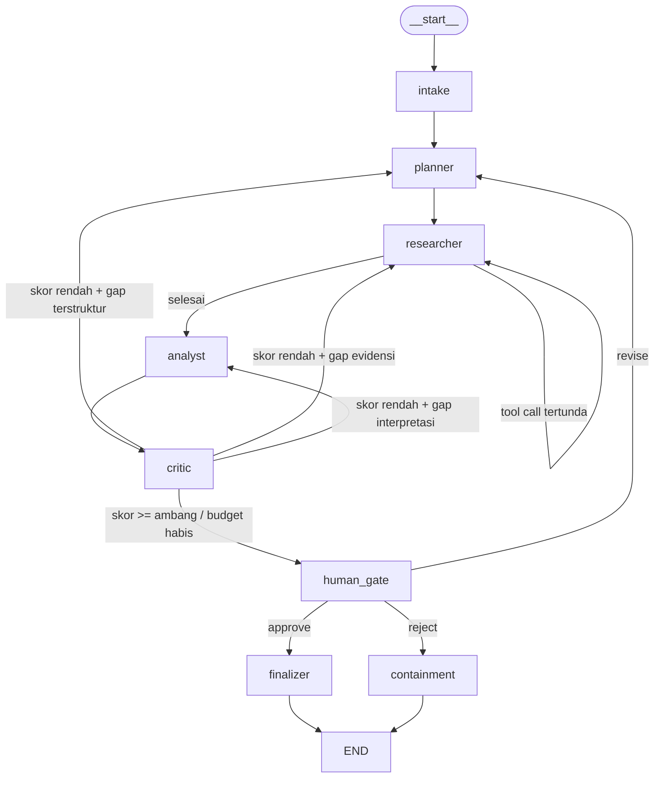

# SIGMA — Strategic Intelligence · Graph-based Multi-Agent Analytics

Platform analitik profesional interaktif berbasis orkestrasi multi-agen
**LangGraph**. SIGMA menerima satu pertanyaan analitik dan mengembalikan brief
yang dapat diaudit: temuan terkuantifikasi, bukti jejak-tool, skor rubrik, dan
rekomendasi aksi — dengan **manusia di dalam loop** sebelum keputusan final.

Dokumen induk: [`docs/PROPOSAL_PRD.md`](docs/PROPOSAL_PRD.md).

```bash
bash apps/sigma/scripts/bootstrap.sh                 # venv + deps + prune + tes + audit
/home/user/sigma-venv/bin/sigma serve --host 0.0.0.0 --port 8000
# -> buka http://localhost:8000
```

---

## Mengapa graf siklik, bukan DAG

Kualitas sebuah analitik tidak diketahui di awal; ia baru terukur setelah
evidensi terkumpul. Karena itu:

| Kebutuhan | Konsekuensi arsitektur |
| --- | --- |
| Jumlah iterasi ditentukan saat *run* | siklus, bukan N stage duplikasi |
| Koreksi terarah (rencana / evidensi / interpretasi) | satu *conditional edge* dengan 3 target |
| Memori lintas iterasi | reducer + checkpointer (transaksional) |
| Persetujuan manusia | `interrupt()` **di dalam** node |
| Melanjutkan sesi setelah crash | `thread_id` + SQLite |

Keempat klaim ini diuji, bukan diklaim: `tests/test_cycles.py` membaca kembali
urutan node dari audit trail dan membuktikan graf benar-benar mengulang node
(`critic → researcher → critic`), bahwa target revisi berbeda mengikuti kelas
gap, dan bahwa siklus berhenti pada budget.

## Arsitektur



* **Mikro-siklus** `researcher → researcher`: pengumpulan tool hingga tidak ada
  panggilan baru yang diajukan.
* **Makro-siklus** `critic → {planner | researcher | analyst}`: koreksi-diri
  terarah; satu revisi dihabiskan per siklus sehingga terminasi terjamin.
* **HITL** `human_gate`: `interrupt(payload, response_schema=HumanDecision)`;
  dijawab dengan `Command(resume=...)`.
* **Fallback** `containment`: kegagalan fatal menghasilkan brief terdegradasi
  yang jujur, bukan eksepsi kosong.

### State

`TypedDict` sebagai envelope, **Pydantic** untuk isi, dan **reducer eksplisit**
untuk setiap field yang bertumbuh (`bounded_add`, `merge_unique_by`,
`supersede_by`, `merge_budget`). Tidak ada field list yang mengandalkan
last-value: bila itu terjadi, bukti dari iterasi sebelumnya akan hilang dan
siklus akan berputar tanpa kemajuan.

### Provider LLM

`DeterministicProvider` (default, offline, deterministik terhadap seed) ·
`HttpChatProvider` (OpenAI-compatible via `httpx`) · `LangChainChatProvider`
(bridge opsional). Node meminta **output terstruktur** (Pydantic) dan otomatis
jatuh ke mesin deterministik bila model tidak tersedia atau mengembalikan sampah
— diuji di `tests/test_llm.py`.

## Antarmuka

| Permukaan | Perintah / endpoint |
| --- | --- |
| Web console | `GET /` (HTML/CSS/JS vanilla, tanpa build step) |
| REST | `POST /api/sessions`, `GET /api/sessions/{id}`, `POST /api/sessions/{id}/resume` |
| Time-travel | `GET /api/sessions/{id}/timeline`, `GET .../timeline/{cp}`, `POST .../fork` |
| Streaming | `GET /api/sessions/stream?question=...` (SSE per node) |
| Kesehatan & audit | `GET /api/health` (ukuran artefak vs budget) |
| CLI | `sigma run`, `sigma sessions`, `sigma timeline`, `sigma resume`, `sigma audit-size`, `sigma serve` |

## Anggaran ukuran (hard gate < 125 MB)

```
component                      size (MB)
runtime dependencies               50.89
application code                    0.62
static assets                       0.02
checkpoint database                 ~0.1
TOTAL                              51.53   (BUDGET 125.00 · headroom 58.8%)
```

Cara mencapainya: LangGraph dipasang *editable* langsung dari `libs/` (nol salinan
wheel), `pytest` diganti `unittest` stdlib, `zstandard`/`pygments` dipangkas,
`__pycache__` dan `tests/` bawaan distribusi dibuang, dan `streamlit`/`pandas`/
`numpy`/SDK vendor dilarang. Audit dijalankan sebagai **test**:
`python -m unittest tests.test_size`, atau `scripts/audit_size.py` (exit 1 bila
melebihi budget).

## Pengujian

```bash
/home/user/sigma-venv/bin/python -m unittest discover -s apps/sigma/tests -t apps/sigma
```

138 tes, hermetik (tanpa jaringan, tanpa kredensial): state/reducer, topologi &
siklus, routing, tool, LLM & fallback, HITL, persistence/time-travel, API, dan
gate ukuran.
