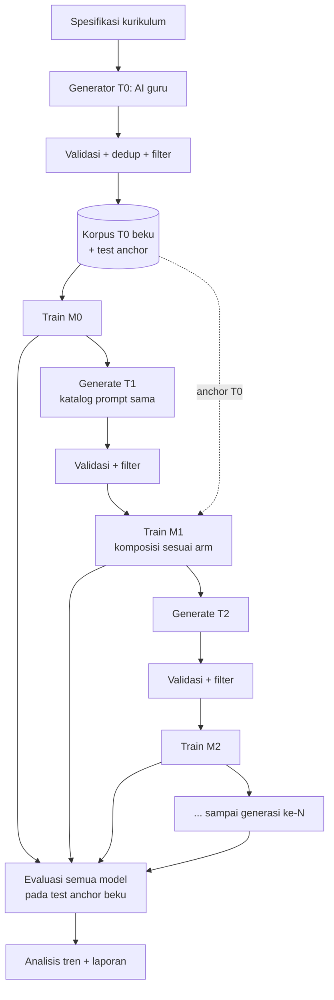

# Rencana Eksperimen — "AI Belajar dari AI"

**Membangun model bahasa dari nol, dengan data pelatihan yang seluruhnya dihasilkan oleh AI, untuk mengukur risiko *model collapse* dan degenerasi lintas generasi.**

| Field | Nilai |
| --- | --- |
| Status | Draft rencana (belum ada kode dieksekusi) |
| Versi | 0.1 |
| Tanggal | 2026-11-01 |
| Lokasi kerja | `experiments/ai-belajar-dari-ai/` |
| Sifat | Eksperimen riset kecil, non-produksi, tidak untuk dirilis sebagai model siap pakai |
| Estimasi durasi | 6 minggu (dengan pilot 1 hari di awal) |
| Estimasi komputasi | ±100 GPU-jam (T4/P100 kelas Colab/Kaggle) + ±2 vCPU-jam/hari untuk pipeline |

---

## 1. Ringkasan eksekutif

Kita akan melatih sebuah model bahasa **dari nol** (bukan fine-tuning model jadi) dengan dua jenis data:

1. **Korpus T0 — ditulis langsung oleh AI (aku).** Kurikulum, soal, jawaban, narasi, dan kode yang aku generate sendiri dari spesifikasi yang kita tetapkan. Ini adalah "dunia asli"-nya eksperimen: satu-satunya sumber kebenaran.
2. **Korpus T1..Tn — dihasilkan oleh model siswa itu sendiri.** Model generasi ke-1 membuat data untuk generasi ke-2, generasi ke-2 membuat data untuk generasi ke-3, dan seterusnya.

Pertanyaan intinya bukan "bisakah AI melatih AI" (jawabannya jelas bisa), melainkan **apa yang hilang, kapan hilangnya, dan apakah bisa dideteksi sebelum modelnya jadi tidak berguna.** Eksperimen ini mereplikasi protokol *recursive training* yang dipakai literatur *model collapse*, dalam skala kecil yang bisa dijalankan satu orang dalam hitungan minggu.

Luaran:
- Deret model M0 → M6 beserta korpus tiap generasi (dengan tanda asal-usul / *lineage*).
- Kurva degenerasi: perplexity pada data anchor, keanekaragaman leksikal, cakupan ekor distribusi, akurasi tugas terverifikasi, dan tingkat memorisasi verbatim.
- Laporan bergaya *paper* (8–12 halaman) berisi hasil, batasan, dan rekomendasi praktis.

**Yang paling penting untuk ekspektasi kita:** hasil yang paling mungkin adalah **degenerasi bertahap yang terukur**, bukan "AI jadi bodoh total dalam 3 putaran". Bila eksperimen justru menunjukkan stabilitas, itu juga temuan yang sah — dan kita akan bisa menjelaskan *kenapa* (lihat §5, peran data anchor).

---

## 2. Pertanyaan riset & hipotesis

### 2.1 Pertanyaan riset

| ID | Pertanyaan |
| --- | --- |
| RQ1 | Seberapa cepat kualitas model turun ketika data pelatihan generasi ke-*k* seluruhnya berasal dari model generasi ke-*(k-1)*? |
| RQ2 | Sinyal apa yang **paling awal** mendeteksi penurunan? (loss? diversitas? ekor distribusi? akurasi faktual?) |
| RQ3 | Apakah menyimpan sebagian data T0 di setiap generasi (*anchoring*) memperlambat atau menghentikan penurunan, dan berapa fraksi minimum yang cukup? |
| RQ4 | Apakah model generasi lanjut mulai **menghafal** (regurgitasi verbatim) data pelatihannya, dan seberapa cepat? |
| RQ5 | Apakah degradasi bersifat seragam, atau menghilangkan dulu "kemampuan rapuh" tertentu (mis. aritmetika, kode, penalaran panjang) sementara bahasa sehari-hari tetap tampak wajar? |

### 2.2 Hipotesis (dengan arah yang diprediksi)

| ID | Hipotesis | Prediksi | Dasar |
| --- | --- | --- | --- |
| H1 | Penggantian total (replace) menyebabkan penurunan monoton pada metrik kualitas | Loss pada anchor naik, diversitas turun tiap generasi | Shumailov dkk. (2024); Alemohammad dkk. (2024) |
| H2 | Akumulasi + anchor T0 menstabilkan model | Kurva mendatar, bukan menyebar | Gerstgrasser dkk. (2024); Feng dkk. (2025) |
| H3 | Ekor distribusi hilang lebih dulu daripada rata-rata | Token langka & tugas "long-tail" jatuh sebelum perplexity rata-rata terlihat buruk | Dohmatob dkk. (2024) |
| H4 | Verifikasi/filtering memperpanjang umur loop | Generasi bertahan lebih lama saat data difilter dengan *checker* deterministik (unit test, evaluasi aritmetika) | Feng dkk. (2025) |
| H5 | Degradasi tidak seragam antar-domain | Domain terverifikasi (matematika/kode) turun lebih tajam daripada narasi bebas | Novel, akan diukur |

Hipotesis **H5** adalah kontribusi orisinal kecil kita; sisanya replikasi terkontrol.

### 2.3 Yang secara eksplisit TIDAK kita klaim

- Tidak mengklaim apa pun tentang model skala besar (≥1B parameter) atau data web-skala.
- Tidak mengklaim bahwa data sintetis "berbahaya" secara umum — literatur justru menunjukkan sintetis + verifikasi bisa membantu.
- Tidak mengklaim hasil ini berlaku untuk arsitektur selain decoder-only transformer kecil.
- Tidak menghasilkan model yang layak dipakai; semua checkpoint diberi label `EXPERIMENTAL-DEGRADED`.

---

## 3. Prinsip desain

1. **Satu variabel berubah per arm.** Yang berubah antar-arm hanyalah komposisi data (replace vs accumulate vs anchor) — bukan arsitektur, tokenizer, atau hyperparameter.
2. **Anchor beku.** Korpus T0 + split test-nya dibekukan dengan hash SHA-256 sebelum training pertama dan tidak pernah diubah. Ini "realitas" pembanding kita.
3. **Lineage eksplisit.** Setiap dokumen punya `gen`, `parent_run`, `generator`, `seed`, dan `hash`. Mustahil mencampur data tanpa tercatat.
4. **Semua bisa diulang.** Setiap run menyimpan `config.yaml`, seed, commit git, versi tokenizer, hash korpus, dan log hardware.
5. **Gagal cepat, murah dulu.** Pilot 1 hari di skala mini sebelum belanja 100 GPU-jam.
6. **Pra-registrasi.** Metrik utama, ambang "collapse", dan uji statistik ditetapkan di §11 **sebelum** run skala penuh, supaya kita tidak menarasikan hasil setelah melihatnya.

---

## 4. Peran AI dalam eksperimen ini (jelas dan jujur)

Ini bagian yang paling mudah disalahpahami, jadi ditulis eksplisit.

| Peran | Siapa | Apa yang dikerjakan |
| --- | --- | --- |
| **Arsitek kurikulum + penulis T0** | Aku (AI guru) | Menyusun taksonomi topik, menulis ±800 dokumen T0 (±2,5 juta token) dari spesifikasi, membuat *fact sheet* & soal uji |
| **Validator T0** | Aku + skrip | Menyaring duplikat, kontradiksi, format rusak, dan konten yang tidak layak; memberi skor kualitas |
| **Generator T1..Tn** | Model siswa lokal | Menjawab katalog prompt yang **sama** dengan yang dipakai untuk T0; hasilnya jadi korpus generasi berikutnya |
| **Juri/evaluator** | Skrip deterministik (bukan AI) | Unit test, cek aritmetika, cek format; AI hanya dipakai sebagai *cross-check* sekunder, tidak sebagai satu-satunya penilai |

**Konsekuensi metodologis yang harus kita sadari:**

- Kalau **aku** yang men-generate data di *setiap* generasi, loop-nya tidak akan pernah kolaps — aku guru tetap (*fixed teacher*). Itu bukan eksperimen model collapse, itu eksperimen distilasi.
- Karena itu generasi ≥1 **wajib** dihasilkan model siswa sendiri. Itulah yang menciptakan umpan balik yang kita ingin ukur.
- Arm kontrol C (§5) memakai "guru tetap" justru untuk mengukur **batas atas** kualitas yang bisa dicapai — pembanding agar kita tahu berapa banyak penurunan yang disebabkan rekursi, bukan keterbatasan model kecil.

---

## 5. Desain eksperimen

### 5.1 Diagram alur



### 5.2 Arm eksperimen

Semua arm memakai model, tokenizer, dan hyperparameter identik. Hanya komposisi data berbeda.

| Arm | Nama | Data generasi ke-*k* | Tujuan |
| --- | --- | --- | --- |
| **A** | `replace` | 100% keluaran M(k-1) | Replikasi protokol collapse klasik (H1) |
| **B** | `accumulate` | Seluruh data T1..T(k-1) + T0 (pool tumbuh), sampel tetap ukuran sama | Uji akumulasi (H2) |
| **C** | `fixed-teacher` | 100% keluaran **AI guru** (aku), bukan model siswa | Batas atas / kontrol distilasi |
| **D1** | `anchor-10` | 90% sintetis + 10% T0 | Titik fraksi anchor |
| **D2** | `anchor-25` | 75% sintetis + 25% T0 | Titik fraksi anchor |
| **E** | `verified-only` | 100% sintetis, tapi hanya yang lolos *checker* deterministik | Uji filtering (H4) |

### 5.3 Matriks run

| Faktor | Nilai |
| --- | --- |
| Generasi (N) | 6 (M0 → M6) |
| Arm | A, B, C, D1, D2, E (6 arm) |
| Seed | 3 (`13`, `1337`, `2024`) |
| Ukuran model | Konfigurasi **S** untuk semua run utama; konfigurasi **M** hanya di arm A & B, seed `13`, sebagai cek skala |

Total run utama: 6 arm × 3 seed × 7 model (M0–M6) = **126 training run**. Dengan konfigurasi S (±10–20 menit/run di T4) ini ±40 GPU-jam; ditambah generasi korpus dan evaluasi, total realistis **±90–110 GPU-jam**.

Catatan: M0 identik untuk semua arm dengan seed yang sama, jadi bisa di-*share* (hemat 12 run).

### 5.4 Katalog prompt (kunci replikasi)

Agar perbandingan antar-generasi adil, **pertanyaan yang diajukan ke M(k-1) harus sama** dengan yang dipakai saat menulis T0. Ini inti protokol Shumailov: distribusi input tetap, distribusi output yang menyusut.

Katalog: 200 prompt × 6 domain = 1.200 prompt, masing-masing diminta menghasilkan ±2.000 token → ±2,4 juta token per generasi.

| Domain | Contoh prompt | Checker |
| --- | --- | --- |
| Aritmetika | "Buat 5 soal cerita penjumlahan dua digit beserta langkah penyelesaiannya." | Eksekusi ulang jawaban secara programatik |
| Kode | "Tulis fungsi Python yang membalik urutan kata; sertakan 3 contoh penggunaan." | Jalankan di sandbox + bandingkan output |
| Faktual terbatas | "Jelaskan siklus air berdasarkan fakta berikut: {fact_sheet}." | Cek kecocokan entitas & angka dengan `fact_sheet` |
| Narasi | "Ceritakan kisah 400 kata tentang {persona} di {setting}." | Tidak ada checker deterministik; pakai diversitas + juri |
| Dialog | "Tulis percakapan 12 giliran antara {peran_a} dan {peran_b} soal {topik}." | Format + jumlah giliran |
| Ringkasan/definisi | "Definisikan {istilah} dan beri 2 contoh serta 1 non-contoh." | Cakupan istilah langka (long-tail probe) |

`fact_sheet` adalah daftar fakta sintetis yang **hanya ada di T0** (mis. "Zat X melebur pada 431 K"). Model yang lupa ekor distribusi akan salah menjawab ini jauh sebelum loss rata-ratanya memburuk — ini probe RQ3/H3.

---

## 6. Spesifikasi teknis

### 6.1 Konfigurasi model (dari nol, decoder-only)

| Komponen | Konfigurasi **S** (utama) | Konfigurasi **M** (cek skala) |
| --- | --- | --- |
| Parameter | ±8 juta (non-embedding ±3 jt) | ±30 juta |
| Layer / d_model / head | 4 / 256 / 4 | 8 / 512 / 8 |
| FFN | SwiGLU, rasio ±2,7 | SwiGLU, rasio ±2,7 |
| Normalisasi | RMSNorm (pre-LN) | RMSNorm (pre-LN) |
| Posisi | RoPE | RoPE |
| Context | 512 token | 512 token |
| Vocab | 8.192 (BPE dilatih **hanya** pada T0) | 8.192 |
| Dropout | 0,0 | 0,0 |
| Weight tying | Ya | Ya |

Tokenizer **hanya** dilatih pada T0 (bukan pada data sintetis generasi lanjut) agar ukuran vocab tidak menjadi variabel pengganggu — dan agar kita bisa melihat token apa yang jadi jarang/tidak terpakai seiring generasi.

### 6.2 Hyperparameter training (identik di semua run)

| Hyperparameter | Nilai | Catatan |
| --- | --- | --- |
| Optimizer | AdamW (β=0,9 / 0,95) | |
| LR | 3e-3 (S) / 1,5e-3 (M), cosine + 200 step warmup | |
| Weight decay | 0,1 | |
| Batch | 64 sekuens × 512 token = 32.768 token/step | |
| Token per generasi | 3 juta (S) / 10 juta (M) | Ukuran korpus per generasi, konstan |
| Epoch | 4 (S) / 3 (M) sampai anggaran token habis | Sama untuk semua arm supaya adil |
| Grad clip | 1,0 | |
| Presisi | bf16/fp16 AMP | |
| Seed | tetap per run | |

**Aturan keadilan anggaran:** setiap model generasi ke-*k* melihat **jumlah token latih yang sama**, berapa pun besar pool datanya. Kalau tidak, arm accumulate akan menang hanya karena melihat lebih banyak data.

### 6.3 Ukuran korpus & komputasi

| Item | Nilai |
| --- | --- |
| T0 (ditulis AI guru) | ±2,5 juta token, ±800 dokumen |
| Korpus per generasi | ±2,4 juta token (hasil 1.200 prompt) |
| Total data yang dihasilkan sepanjang eksperimen | ±20 juta token (semuanya sintetis) |
| Penyimpanan | ±150 GB (korpus + 126 checkpoint × ±30 MB + log) |
| GPU | 1× T4/P100 16 GB cukup; A100/L4 lebih nyaman |
| Waktu training/run | 10–20 menit (S), ±45 menit (M) |
| Waktu generasi korpus/run | ±1,5 jam untuk 2,4 jt token @ ±450 token/detik |
| Total | ±100 GPU-jam, bisa dicicil 2 minggu di Kaggle/Colab |

**Fallback CPU-murni** (kalau tidak ada GPU): pakai konfigurasi **XS** (2 juta parameter, 4 layer d=128, vocab 4.096, 800 ribu token/generasi, 5 generasi, 2 arm, 1 seed). Estimasi 3–6 jam/run di 8 vCPU. Kesimpulan yang bisa ditarik jauh lebih lemah (skala terlalu kecil), dan itu harus ditulis di laporan.

### 6.4 Stack

| Kebutuhan | Pilihan | Alasan |
| --- | --- | --- |
| Training | PyTorch 2.x, ditulis manual (tanpa HF Trainer) | Kontrol penuh, transparan, ±600 baris |
| Tokenizer | `tokenizers` (BPE) | Cepat, deterministik |
| Orkestrasi pipeline | **LangGraph** (repo ini) + `SqliteSaver` | Node/state/checkpoint, resume kalau run mati, interrupt di gate manusia |
| Logging | TensorBoard lokal + JSONL metrik | Tanpa dependensi cloud |
| Manifest data | JSONL + hash SHA-256, disimpan di git (kecil) | Telusur lineage |
| Artefak besar | `data/`, `checkpoints/`, `runs/` → `.gitignore` | Jangan masuk git |
| Analisis | pandas + matplotlib + scipy/statsmodels | |

---

## 7. Pipeline data (7 tahap)

### 7.1 Tahap

1. **Spec & taksonomi** — 6 domain × sub-topik × level kesulitan; disimpan sebagai YAML, versi dikunci.
2. **Generate** — untuk T0 oleh AI guru; untuk T(k) oleh M(k-1) dengan katalog prompt yang sama + `temperature=0.9, top_p=0.95` (dikunci, karena sampling mempengaruhi collapse).
3. **Normalisasi** — buang artefak markup, samakan encoding UTF-8, potong/dokumen ulang ke ≤512 token dengan penanda `doc_id`.
4. **Dedup** — MinHash (Jaccard ≥ 0,8) di dalam generasi dan antar-generasi; simpan tingkat duplikasi sebagai metrik (naiknya duplikasi = sinyal awal collapse).
5. **Filter kualitas** — aturan: panjang minimum, rasio token unik, deteksi pengulangan n-gram, bahasa, format; untuk domain terverifikasi: jalankan *checker*.
6. **Balance** — pastikan proporsi domain sama antar-generasi (kalau tidak, pergeseran distribusi domain akan mengacaukan analisis).
7. **Bekukan & manifest** — hitung hash, tulis `manifest.jsonl`, tandai `frozen_at`.

### 7.2 Skema satu baris data

```json
{
  "doc_id": "t1-a-0137",
  "gen": 1,
  "arm": "A",
  "domain": "code",
  "prompt_id": "p-code-0042",
  "generator": "M0-s13",
  "parent_run": "run-A-s13-M0",
  "text": "...",
  "n_tokens": 1987,
  "sha256": "9f2c...",
  "checks": {"format_ok": true, "runs": true, "arith_ok": null},
  "quality_score": 0.71,
  "canary": "CANARY-G1-7B31A9"
}
```

### 7.3 Canary & watermark lineage

Setiap dokumen generasi ke-*k* diberi string penanda unik yang sangat jarang (mis. `CANARY-G1-7B31A9`) yang **tidak** pernah muncul di T0. Tiga kegunaan:

1. **Deteksi kontaminasi**: kalau `CANARY-G1` muncul di korpus G3 dalam jumlah besar, kita tahu lineage-nya bercampur (bug pipeline) atau model menghafal.
2. **Ukur memorisasi (RQ4)**: prompt-prefix 20 token dari dokumen latih → ukur laju regurgitasi persis ≥50 token. Ini *extraction rate*.
3. **Ukur amplifikasi**: proporsi token canary lama yang bertahan di generasi baru = proksi seberapa besar "masa lalu" direproduksi.

---

## 8. Orkestrasi dengan LangGraph

Eksperimen ini punya banyak langkah panjang dan bisa mati di tengah; kita pakai LangGraph sebagai runtime orkestrasi (bukan sebagai bagian dari model).

```python
# Sketsa state + graf (belum dijalankan; bagian dari fase implementasi)
class ExpState(TypedDict):
    gen: int
    arm: str
    seed: int
    corpus_dir: str
    corpus_sha: str
    model_dir: str
    metrics: dict[str, float]
    gate: str  # "continue" | "stop" | "needs_human"
```

| Node | Fungsi | Checkpoint |
| --- | --- | --- |
| `plan_prompts` | Muat katalog prompt beku, pastikan hash sama dengan generasi sebelumnya | ya |
| `generate_corpus` | Jalankan generator (AI guru untuk T0, model siswa untuk T≥1) | ya, per batch 50 dokumen |
| `validate` | Normalisasi, dedup, filter, checker | ya |
| `freeze` | Hash + manifest + canary | ya |
| `train` | Subprocess training → `model_dir`, log ke TensorBoard | ya (heartbeat tiap 100 step) |
| `evaluate` | Semua metrik §10 pada test anchor beku | ya |
| `gate` | Aturan keputusan §11; `interrupt()` bila `needs_human` | ya (HITL) |

Kenapa LangGraph di sini berguna secara nyata: run 100+ jam akan terputus (kuota Colab habis, kernel mati). Dengan checkpointer SQLite, kita bisa resume tepat di node terakhir, dan gate manusia bisa menghentikan seluruh sweep sebelum membakar sisa kuota.

**Catatan penting**: LangGraph hanya mengorkestrasi. Model, tokenizer, dan data tidak boleh bergantung pada LangGraph — supaya eksperimen tetap bisa dijalankan ulang tanpa framework (reproducibility).

---

## 9. Rencana training & eksekusi

| Langkah | Detail |
| --- | --- |
| 9.1 | Bekukan T0 + split: 96% train / 2% valid / 2% test-anchor (test **tidak pernah** dipakai untuk memilih checkpoint) |
| 9.2 | Train M0 untuk semua seed; pastikan loss test-anchor M0 wajar (±3,5–4,5 nat/token untuk model sekecil ini; kalibrasi setelah pilot) |
| 9.3 | Untuk setiap arm: generate → validasi → pilih subset sesuai komposisi → train M(k) |
| 9.4 | Simpan semua checkpoint; jangan hapus yang buruk (yang buruk justru datanya) |
| 9.5 | Evaluasi setiap checkpoint pada test anchor + probe set (tetap, beku) |
| 9.6 | Evaluasi *silang-generasi*: M0..M6 semuanya dievaluasi dengan set yang sama, satu kali, di akhir — plus evaluasi inkremental untuk memantau |
| 9.7 | Analisis & laporan |

**Aturan anti-kontaminasi:** test anchor tidak boleh masuk ke prompt katalog, tidak boleh dipakai sebagai few-shot, dan filenya diberi izin read-only.

---

## 10. Evaluasi & metrik

### 10.1 Empat keluarga metrik

**A. Kualitas terhadap "realitas" (anchor)**

| Metrik | Definisi | Kenapa penting |
| --- | --- | --- |
| `anchor_loss` / `ppl` | Cross-entropy M(k) pada test-anchor T0 | Ukuran utama: seberapa jauh model melenceng dari dunia asli |
| `kl_anchor` | KL(P_T0 ‖ P_Mk) per posisi | Mendeteksi penyempitan distribusi |
| `fact_probe_acc` | Akurasi pada 300 pertanyaan yang jawabannya hanya ada di `fact_sheet` T0 | Retensi pengetahuan langka |

**B. Keanekaragaman & ekor distribusi**

| Metrik | Definisi |
| --- | --- |
| `distinct-1/2/3` | Rasio n-gram unik / total n-gram pada 500 sampel generasi |
| `self_bleu` | BLEU antar-sampel (tinggi = homogen) |
| `mauve` | Divergensi distribusi M(k) vs M0 pada embedding kalimat |
| `vendi_score` | Keanekaragaman efektif dari himpunan sampel |
| `type_token_ratio` | Rasio tipe/token |
| `tail_coverage` | Proporsi token yang tergolong "langka di T0" (rank > 1.000) yang masih muncul di keluaran |
| `hapax_ratio` | Proporsi kata yang muncul satu kali |
| `dup_rate` | Tingkat duplikasi korpus generasi (MinHash) |

**C. Kemampuan terverifikasi (objektif, bukan penilaian model)**

| Metrik | Definisi |
| --- | --- |
| `arith_acc` | Eksekusi ulang jawaban aritmetika; benar/salah dihitung program |
| `code_pass@1` | Unit test pada 120 soal kode; dijalankan di sandbox tanpa jaringan |
| `format_valid` | Persentase keluaran yang mematuhi skema yang diminta |
| `repetition_rate` | Fraksi 8-gram berulang di dalam satu dokumen |

**D. Patologi & memorisasi**

| Metrik | Definisi |
| --- | --- |
| `extraction_rate` | Laju regurgitasi verbatim ≥50 token saat diberi prefix dari data latih (RQ4) |
| `canary_leak` | Kemunculan canary generasi lama di korpus generasi baru |
| `degenerate_rate` | Fraksi sampel dengan loop/karakter rusak/keluaran kosong |
| `bias_drift` | Pergeseran distribusi sentimen & penyebutan kelompok pada prompt netral |

### 10.2 Protokol sampling evaluasi

- 500 sampel per model per metrik generatif, `temperature=1.0, top_p=1.0` (sampling **tidak** di-*truncate*, karena truncation sendiri menyempitkan distribusi dan akan mengaburkan efek).
- Prompt evaluasi diambil dari katalog yang sama, tetapi dengan `prompt_id` yang **tidak** dipakai saat training (held-out prompts).
- Semua evaluasi deterministik dijalankan 3× dengan seed berbeda; laporkan rata-rata ± 95% CI *bootstrap*.

### 10.3 Definisi operasional "collapse"

Agar tidak debat kusir setelah melihat grafik, kita tetapkan di muka. Sebuah arm dianggap **mengalami collapse** bila, pada generasi ke-*k*:

```text
anchor_ppl(M_k) ≥ 1.5 × anchor_ppl(M_0)
DAN
(distinct_2 turun ≥ 30% relatif M_0 ATAU code_pass@1 turun ≥ 50% relatif M_0)
```

Terjadi pada ≥2 dari 3 seed. Ini definisi konservatif dan mudah direplikasi orang lain.

---

## 11. Pra-registrasi & kriteria keputusan

Ditulis dan dikunci **sebelum** run skala penuh (file `PREREGISTRATION.md`, commit terpisah).

| Hal | Keputusan |
| --- | --- |
| Metrik utama | `anchor_ppl` |
| Metrik sekunder | `distinct-2`, `tail_coverage`, `code_pass@1`, `fact_probe_acc`, `extraction_rate` |
| Uji tren | Jonckheere–Terpstra (tren monoton) + regresi linear campuran (`gen` sebagai fixed effect, `seed` sebagai random) |
| Tingkat signifikansi | α = 0,05, dengan koreksi Holm untuk 5 metrik sekunder |
| Ambang collapse | §10.3 |
| Aturan berhenti | Hentikan arm bila collapse terpenuhi di 2 seed, atau generasi mencapai N=6 |
| Ambang "layak dilanjutkan" | Kalau M0 tidak mencapai `anchor_ppl` < ambang kalibrasi setelah pilot, perbaiki T0 dulu — jangan lanjut |
| Analisis eksploratif | Boleh, tapi wajib diberi label "exploratory" di laporan |

**Gate manusia (HITL)**: setelah pilot, setelah M0 stabil, dan sebelum sweep penuh. Di titik itu aku berhenti dan minta konfirmasi.

---

## 12. Deliverable

| # | Artefak | Lokasi | Keterangan |
| --- | --- | --- | --- |
| D1 | Rencana ini | `PLAN.md` | Dokumen hidup, versi 0.1 |
| D2 | Pra-registrasi | `PREREGISTRATION.md` | Dikunci sebelum run penuh |
| D3 | Spesifikasi data & prompt | `docs/data-spec.md`, `prompts/` | Katalog beku, versi hash |
| D4 | Kode pipeline | `src/` (generate, validate, train, eval, orchestrate) | ±1.500 baris |
| D5 | Korpus + manifest | `data/` (di-`.gitignore`), `manifests/*.jsonl` (di git) | Lineage lengkap |
| D6 | Checkpoint M0–M6 semua arm | `checkpoints/` (di-`.gitignore`) | Label `EXPERIMENTAL-DEGRADED` |
| D7 | Dashboard & tabel hasil | `analysis/` → PNG + CSV | 8 grafik inti |
| D8 | Laporan | `REPORT.md` + `paper.pdf` | 8–12 halaman, termasuk batasan |
| D9 | Reproduksi satu-perintah | `Makefile` (`make pilot`, `make sweep`, `make report`) | Deterministik |
| D10 | Dashboard transparansi | `dashboard/index.html` + `build.py` + `status.json` | Dirender dari dokumen ini; memuat status, peta kode, dan klaim + cara verifikasinya |

Grafik inti yang wajib ada:
1. `anchor_ppl` vs generasi, per arm (dengan CI).
2. `distinct-2` vs generasi.
3. `tail_coverage` vs generasi.
4. `code_pass@1` & `arith_acc` vs generasi.
5. `extraction_rate` vs generasi.
6. Scatter: diversitas korpus vs kualitas model (tiap titik = satu generasi).
7. Perbandingan arm A vs B vs D1/D2 (efek anchor).
8. Cuplikan kualitatif: contoh keluaran M0 vs M3 vs M6 untuk prompt yang sama.

---

## 13. Timeline 6 minggu

| Minggu | Fokus | Luaran | Gate |
| --- | --- | --- | --- |
| 0 (1 hari) | **Pilot mini**: 200 ribu token T0, model XS, 3 generasi, 1 arm, 1 seed | Pipeline end-to-end jalan, ada angka pertama | ✋ Konfirmasi lanjut |
| 1 | Tulis T0 (±2,5 jt token) + katalog prompt + split beku | T0 + manifest + tokenizer | Review kualitas T0 |
| 2 | Training harness, evaluator, orkestrasi LangGraph, unit test | `make pilot` hijau | ✋ Cek M0 sehat |
| 3 | Refactor pipeline, jalankan arm A & C (3 seed) | Kurva pertama replace vs fixed-teacher | Cek anomali |
| 4 | Arm B, D1, D2, E; konfigurasi M untuk cek skala | Semua 126 run selesai | ✋ Sebelum analisis |
| 5 | Analisis statistik, uji hipotesis, grafik | Tabel + 8 grafik + draft hasil | — |
| 6 | Laporan, batasan, rekomendasi, rilis internal | `REPORT.md` + `paper.pdf` | ✋ Review akhir |

Jadwal ini mengasumsikan ±15 jam kerja manusia/AI per minggu. Kalau kuota GPU terbatas, urutan prioritas: **pilot → arm A → arm C → arm B → sisanya**.

---

## 14. Risiko & mitigasi

### 14.1 Risiko teknis

| Risiko | Dampak | Sinyal | Mitigasi |
| --- | --- | --- | --- |
| Model terlalu kecil → hasil tidak informatif | Tinggi | `anchor_ppl` M0 > 6 nat/token, keluaran tidak koheren | Kalibrasi di pilot; naikkan ke konfigurasi M |
| Run mati di tengah (kuota GPU) | Sedang | Heartbeat berhenti | Checkpoint LangGraph + resume; run disimpan per batch |
| Data sintetis rusak format → training gagal senyap | Sedang | `format_valid` < 80% | Filter keras; tolak generasi, ulangi dengan prompt perbaikan |
| Kebocoran test-anchor ke training | **Tinggi (mematikan validitas)** | Hash dokumen muncul di korpus | File read-only, cek hash tiap `freeze`, unit test anti-bocor |
| Kontaminasi antar-arm | Tinggi | `canary_leak` > 1% | Direktori terpisah per arm+seed, manifest wajib |
| Kebetulan statistik dengan 3 seed | Sedang | Efek tidak konsisten antar-seed | Laporkan semua seed; jangan pilih yang bagus |
| Perbedaan jumlah token antar-arm | Tinggi | Cek `tokens_seen` di config | Aturan anggaran tetap (§6.2) |

### 14.2 Risiko saintifik

| Risiko | Mitigasi |
| --- | --- |
| Overclaim "AI melatih AI = buruk" | Tulis §2.3 di laporan; arm C menunjukkan distilasi stabil |
| Confounding ukuran model vs rekursi | Konfigurasi identik semua arm; anggaran token sama |
| Sampling/truncation mengaburkan hasil | Sampling evaluasi tanpa truncation, dikunci |
| Tidak bisa direplikasi | Semua hash, seed, config, prompt beku di git |
| "Replikasi" dianggap kontribusi baru | Nyatakan jelas: replikasi + satu kontribusi kecil (H5, per-domain) |

### 14.3 Risiko etika & keamanan

| Risiko | Mitigasi |
| --- | --- |
| Korpus sintetis memuat konten berbahaya (bias, stereotip, instruksi berbahaya) | Spesifikasi prompt melarang kategori berisiko; filter kata kunci + review sampel manual; tidak ada prompt tentang senjata, malware, dsb. |
| Model rusak/tereduksi dirilis dan dipakai orang | Checkpoint tidak dipublikasikan; kalau dirilis, diberi kartu model `EXPERIMENTAL — DEGRADED, DO NOT DEPLOY` |
| Bias menguat lintas generasi tanpa disadari | Metrik `bias_drift` diukur, tidak hanya kualitas |
| Memorisasi data pribadi | T0 tidak memuat data pribadi siapa pun; semua persona fiktif |
| Eksekusi kode hasil model | Sandbox tanpa jaringan, timeout 5 detik, batas memori, `seccomp` bila tersedia |
| Eksperimen disalahartikan sebagai upaya membuat kemampuan berbahaya | Lingkup: 30 juta parameter, ±2,5 juta token; secara kapasitas tidak mampu tugas berbahaya |
| Biaya API/token tak terduga | Hanya T0 yang memakai AI guru (anggaran ±2,5 jt token); generasi lanjut lokal dan gratis; batas harian di pipeline |

### 14.4 Kondisi berhenti (stop conditions)

Hentikan dan lapor, tanpa menunggu jadwal, bila:
1. Test-anchor terdeteksi bocor ke training.
2. `canary_leak` > 5% (menandakan pipeline rusak, bukan fenomena).
3. Korpus memuat konten yang melanggar kebijakan keamanan.
4. Waktu/kuota terpakai > 150% estimasi tanpa hasil yang bisa dianalisis.

---

## 15. Batasan yang harus ditulis di laporan

1. **Skala.** 8–30 juta parameter, 2,5 juta token anchor. Model sebesar ini sudah lemah sejak M0; degradasi karena rekursi bisa tertutup oleh keterbatasan kapasitas.
2. **"Realitas" adalah AI juga.** Anchor T0 ditulis AI, bukan manusia. Jadi yang kita ukur adalah *jarak dari distribusi guru*, bukan *jarak dari dunia*. Model yang "kolaps" mungkin masih benar secara faktual; yang hilang adalah keanekaragaman gaya, cakupan, dan detail.
3. **Domain sempit & sintetis.** Tidak ada data web nyata; distribusi T0 sangat berbeda dari korpus nyata.
4. **Tokenizer dilatih pada T0.** Ini menguntungkan M0 relatif terhadap generasi lanjut.
5. **Tiga seed.** Cukup untuk arah tren, tidak cukup untuk klaim efek kecil.
6. **Satu keluarga arsitektur.** Tidak ada generalisasi ke MoE, model besar, atau multimodal.
7. **Juri untuk domain narasi.** Tidak ada *checker* deterministik untuk kualitas cerita; metrik diversitas bukan proksi kualitas.

---

## 16. Referensi

1. Shumailov, I., Shumaylov, Z., Zhao, Y., Papernot, N., Anderson, R., Gal, Y. *AI models collapse when trained on recursively generated data.* Nature 631, 755–759 (2024).
2. Shumailov, I. dkk. *The Curse of Recursion: Training on Generated Data Makes Models Forget.* arXiv:2305.17493 (2023).
3. Gerstgrasser, M. dkk. *Is Model Collapse Inevitable? Breaking the Curse of Recursion by Accumulating Real and Synthetic Data.* arXiv:2404.01413 (2024).
4. Dohmatob, E. dkk. *Strong Model Collapse.* arXiv:2410.04840 (2024).
5. Alemohammad, S. dkk. *Self-Consuming Generative Models Go MAD.* ICLR 2024.
6. Feng, Y. dkk. *Beyond Model Collapse: Scaling Up with Synthesized Data Requires Verification.* ICLR 2025 (arXiv:2406.07515).
7. Fu, S. dkk. *A Theoretical Perspective: How to Prevent Model Collapse in Self-consuming Training Loops.* ICLR 2025 (arXiv:2502.18865).
8. Eldan, R., Li, Y. *TinyStories: How Small Can Language Models Be and Still Speak Coherent English?* arXiv:2305.07759 (2023).
9. Gunasekar, S. dkk. *Textbooks Are All You Need.* arXiv:2306.11644 (2023).
10. Pillutla, K. dkk. *MAUVE: Measuring the Gap Between Neural Text and Human Text.* NeurIPS 2021.
11. Zhu, Y. dkk. *Texygen: A Benchmarking Platform for Text Generation Models* (Self-BLEU). 2018.
12. Friedman, D., Dieng, A. B. *The Vendi Score.* 2023.

---

## 17. Keputusan yang perlu kamu konfirmasi (sebelum fase implementasi)

Ini pertanyaan yang mengubah desain secara nyata. Default-ku ada di kolom kanan; kalau kamu tidak menjawab, aku pakai default.

| # | Pertanyaan | Opsi | Default-ku |
| --- | --- | --- | --- |
| 1 | Hardware | (a) GPU Colab/Kaggle, (b) GPU lokal, (c) CPU saja | **(a)** — cukup untuk skala S/M |
| 2 | Ambisi | (a) eksperimen cepat & bersih (2 minggu), (b) 6 minggu dengan 6 arm, (c) mini-paper (10 minggu) | **(b)** — tapi pilot 1 hari dulu |
| 3 | Bahasa korpus T0 | (a) Indonesia, (b) Inggris, (c) campuran 70/30 | **(c)** — Indonesia mayoritas, karena tokenizer Indonesia lebih boros token dan efek ekor lebih terlihat |
| 4 | Fokus tambahan | (a) murni teknis, (b) juga bias/keadilan, (c) juga keamanan (memorisasi, ekstraksi) | **(c)** — `extraction_rate` sudah masuk metrik |
| 5 | Publikasi | (a) internal saja, (b) rilis laporan publik tanpa checkpoint, (c) rilis semua | **(b)** |

---

## 18. Langkah berikutnya

Urutan yang aku sarankan, semuanya menunggu lampu hijau darimu:

1. **Hari ini**: konfirmasi §17 (atau bilang "pakai default").
2. **Hari 1 (pilot)**: aku bangun pipeline minimum + 200 ribu token T0 + model 2 juta parameter, 3 generasi. Hasilnya: satu grafik kecil yang membuktikan pipaannya jalan.
3. **Hari 2–3**: aku tulis `PREREGISTRATION.md` dan kunci.
4. **Minggu 1**: T0 skala penuh.

Kalau kamu setuju, langkah 2 bisa aku mulai sekarang — pilotnya cukup kecil untuk dieksekusi di sesi ini juga.
