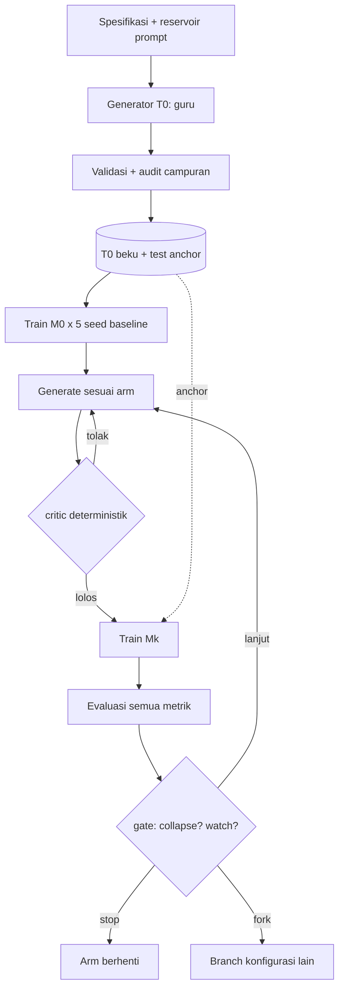

# Rencana Eksperimen — "AI Belajar dari AI"

**Membangun model bahasa dari nol, dengan data pelatihan yang seluruhnya dihasilkan oleh AI, untuk mengukur risiko *model collapse* dan degenerasi lintas generasi.**

| Field | Nilai |
| --- | --- |
| Status | Draft rencana (belum ada kode dieksekusi) |
| Versi | **0.3** |
| Tanggal | 2026-11-01 |
| Versi sebelumnya | v0.1 (`289c20a`), v0.2 (`3153476`), lihat §19 Riwayat |
| Lokasi kerja | `experiments/ai-belajar-dari-ai/` |
| Sifat | Eksperimen riset kecil, non-produksi, tidak untuk dirilis sebagai model siap pakai |
| Estimasi durasi | 7 minggu (pilot 1 hari di awal; bisa dipadatkan ke 6 minggu dengan mematikan Tier 3) |
| Estimasi komputasi | **Berlapis** (§20): P0 ±20–40 menit di sandbox (2 vCPU, tanpa GPU), P1 ±3–5 jam, P2 ±120 GPU-jam di GPU eksternal |

---

## 1. Ringkasan eksekutif

Kita akan melatih sebuah model bahasa **dari nol** (bukan fine-tuning model jadi) dengan dua jenis data:

1. **Korpus T0 — ditulis langsung oleh AI (aku).** Kurikulum, soal, jawaban, narasi, dan kode yang aku generate sendiri dari spesifikasi yang kita tetapkan. Ini adalah "dunia asli"-nya eksperimen: satu-satunya sumber kebenaran.
2. **Korpus T1..Tn — dihasilkan oleh model siswa itu sendiri.** Model generasi ke-1 membuat data untuk generasi ke-2, generasi ke-2 membuat data untuk generasi ke-3, dan seterusnya.

Pertanyaan intinya bukan "bisakah AI melatih AI" (jawabannya jelas bisa), melainkan **apa yang hilang, kapan hilangnya, dan apakah bisa dideteksi sebelum modelnya jadi tidak berguna.**

**Yang berubah di v0.2.** Versi pertama punya tiga celah yang bisa memunculkan *collapse semu* — degradasi yang tampak seperti akibat rekursi padahal disebabkan artefak desain. v0.2 menutupnya:

| Celah di v0.1 | Perbaikan di v0.2 | Bagian |
| --- | --- | --- |
| Arm C disebut "batas atas", padahal ia hanya meniru satu gaya guru | Arm C dipecah jadi C1 (regen), C2 (guru beku & beragam gaya), C3 (dua guru); klaim "upper bound" dicabut | §5.2, §2.3 |
| Tokenizer dilatih di T0 → fragmentasi bisa menyamar sebagai degradasi | Metrik utama pindah ke **bits-per-byte** (tak bergantung tokenizer) + audit fertilitas + analisis per-byte | §6.4, §10.1 |
| Ambang collapse `1.5×` peka variansi seed M0 | Ambang berbasis **σ dari 5 seed M0** + lantai absolut + syarat metrik kedua; `1.5×` hanya jadi pembanding | §10.3, §11 |
| Subsampling Arm B bisa menggeser frekuensi data | Spesifikasi sampler eksplisit (B1 vs B2), audit TVD tiap generasi, kontrol `B3 matched-unigram` | §7.3, §5.2 |
| 1.200 prompt statis berulang → confound "prompt repetition" | Tiga tingkat kebaruan prompt (statis / parafrase / intent baru) sebagai dosis | §5.5 |
| LangGraph hanya dipakai sebagai checkpointer | Graf dengan *conditional routing*, *critic* deterministik, *fork/time-travel*, dan anggaran perbaikan | §8 |

**Yang berubah di v0.3 (hasil audit mandiri, `docs/self-audit-v0.2.md`).** Audit menemukan tiga hal yang tidak nyaman:

1. **Aturan ambang v0.2 salah secara statistik.** Simulasi (`analysis/calibration.py`) menunjukkan `Δ ≥ max(3σ̂, 0,10)` memberi **FWER studi 8,5%** pada skenario derau terburuk, dan aturan tanpa lantai memberi **11,4%** — bukan 0,3%. Penyebabnya aritmetika: variansi selisih adalah `σ²(1+1/5)`, `σ̂` hanya 4 derajat bebas (perlu kuantil t), dan ada 180 uji tanpa koreksi. Aturan primer diganti ke **R7** (§10.5).
2. **Batas deteksi lebih kasar dari yang tersirat.** MDE80 = 0,078–0,233 bpb (5–17% relatif). "Tidak terdeteksi" tidak boleh ditulis sebagai "tidak terjadi".
3. **Studi penuh tidak mungkin di sandbox ini.** Terukur 2 vCPU / 3 GB / tanpa GPU; ±1.067 jam CPU untuk 192 model S. Karena itu eksekusi dibagi menjadi profil P0–P3 dengan kontrak *offline executor* (§20).

Luaran: deret model M0 → M6 untuk 13 arm dalam 3 tier, plus kurva degenerasi lintas metrik, audit validitas, dan laporan bergaya *paper*.

**Ekspektasi yang jujur.** Hasil paling mungkin adalah degradasi bertahap yang terukur, bukan "AI jadi bodoh total dalam 3 putaran". Bila eksperimen justru menunjukkan stabilitas, itu juga temuan yang sah — dan v0.2 dirancang supaya kita bisa membedakan "stabil karena rekursinya jinak" dari "stabil karena metriknya buta".

---

## 2. Pertanyaan riset & hipotesis

### 2.1 Pertanyaan riset

| ID | Pertanyaan | Ditambahkan |
| --- | --- | --- |
| RQ1 | Seberapa cepat kualitas turun ketika data generasi ke-*k* seluruhnya berasal dari model generasi ke-*(k-1)*? | v0.1 |
| RQ2 | Sinyal apa yang **paling awal** mendeteksi penurunan? | v0.1 |
| RQ3 | Apakah menyisakan sebagian T0 memperlambat penurunan, dan berapa fraksi minimumnya? | v0.1 |
| RQ4 | Apakah model generasi lanjut mulai menghafal (regurgitasi verbatim) data pelatihannya? | v0.1 |
| RQ5 | Apakah degradasi menyerang kemampuan rapuh lebih dulu (aritmetika, kode) sebelum bahasa sehari-hari? | v0.1 |
| RQ6 | Berapa besar penurunan yang sebenarnya disebabkan **pengulangan prompt yang sama**, bukan rekursi model? | **v0.2** |
| RQ7 | Apakah collapse bertahan setelah pengaruh leksikal (frekuensi kata) dinetralkan — atau ia memang penyempitan distribusi? | **v0.2** |
| RQ8 | Apakah *critic* deterministik sebelum training menunda collapse, dan berapa biaya token yang dibayar untuk itu? | **v0.2** |
| RQ9 | Apakah homogenisasi gaya bisa muncul **tanpa** penurunan kualitas terukur? | **v0.2** |

### 2.2 Hipotesis

| ID | Hipotesis | Prediksi | Dasar |
| --- | --- | --- | --- |
| H1 | Penggantian total menyebabkan penurunan monoton | Loss anchor naik, diversitas turun tiap generasi | Shumailov dkk. (2024) |
| H2 | Akumulasi + anchor menstabilkan model | Kurva mendatar | Gerstgrasser dkk. (2024) |
| H3 | Ekor distribusi hilang lebih dulu daripada rata-rata | Token langka & tugas long-tail jatuh lebih awal | Dohmatob dkk. (2024) |
| H4 | Verifikasi/filtering memperpanjang umur loop | Arm E bertahan lebih lama | Feng dkk. (2025) |
| H5 | Degradasi tidak seragam antar-domain | Kode & aritmetika turun lebih tajam | Novel (kecil) |
| **H6** | Kebaruan prompt memperlambat collapse | Dosis: statis > parafrase > intent baru (dari yang terburuk) | **v0.2**, uji confound |
| **H7** | Homogenisasi gaya terukur mendahului penurunan kualitas | `style_div` turun sebelum `anchor_bpb` naik | **v0.2** |
| **H8** | Critic menaikkan kualitas tapi menurunkan keragaman | Tradeoff terukur, bukan kemenangan bersih | **v0.2** |
| **H9** | Collapse bukan sekadar pergeseran frekuensi kata | `B3 matched-unigram` tetap kolaps | **v0.2** |
| **H10** | Artefak tokenizer terbatas dan bisa dibuktikan batasnya | Kesimpulan sama pada BPB & analisis per-byte | **v0.2**, falsifiable |

### 2.3 Yang secara eksplisit TIDAK kita klaim

- Tidak mengklaim apa pun tentang model skala besar (≥1B parameter) atau data web-skala.
- Tidak mengklaim bahwa data sintetis "berbahaya" secara umum.
- Tidak mengklaim hasil berlaku untuk arsitektur selain decoder-only transformer kecil.
- **Tidak lagi mengklaim Arm C sebagai batas atas absolut** (v0.1 melakukannya; itu salah). Arm C adalah *batas atas kondisional*: kualitas tertinggi yang bisa dicapai dengan meniru distribusi guru tertentu pada anggaran ini. Ia bisa **lebih rendah** dari yang seharusnya bila gaya guru monoton.
- Tidak mengklaim "collapse" bila yang naik hanya perplexity token-wise tanpa disertai penurunan metrik kedua (lihat §10.3).

---

## 3. Prinsip desain

1. **Satu variabel berubah per arm.** Arsitektur, tokenizer, hyperparameter, dan anggaran identik.
2. **Anchor beku.** T0 + split test dibekukan dengan SHA-256 sebelum training pertama.
3. **Lineage eksplisit.** Tiap dokumen punya `gen`, `parent_run`, `generator`, `seed`, `prompt_id`, `hash`.
4. **Metrik tak bergantung tokenizer dulu, baru metrik token.** Urutan pelaporan: BPB → PPL. (v0.2)
5. **Ambang ditentukan oleh derau baseline, bukan angka bulat.** (v0.2)
6. **Campuran data dideklarasikan sebagai vektor target, lalu diaudit.** (v0.2)
7. **Kebaruan prompt adalah variabel terkontrol, bukan asumsi tersembunyi.** (v0.2)
8. **Gagal cepat, murah dulu.** Pilot 1 hari sebelum 120 GPU-jam.
9. **Pra-registrasi.** Metrik utama, ambang, dan uji ditetapkan sebelum run penuh (§11).

---

## 4. Peran AI dalam eksperimen ini

| Peran | Siapa | Apa yang dikerjakan |
| --- | --- | --- |
| **Arsitek kurikulum + penulis T0** | Aku (AI guru) | Taksonomi, ±800 dokumen T0 (±2,5 juta token), *fact sheet*, prompt reservoir, parafrase prompt |
| **Validator T0** | Aku + skrip | Dedup, kontradiksi, format, kelayakan; skor kualitas |
| **Generator T1..Tn** | Model siswa lokal | Menjawab prompt sesuai tingkat kebaruan arm |
| **Generator korpus guru (C2/C3)** | Aku | Batch terpisah dengan spesifikasi gaya berbeda, **dibuat sekali dan dibekukan** |
| **Juri utama** | Skrip deterministik | Unit test, cek aritmetika, cek format, audit campuran |
| **Juri sekunder** | Aku | Hanya untuk domain tanpa checker (narasi); dilaporkan terpisah |

**Efek yang harus kita sadari (ditambahkan v0.2):**

- **Aku bukan guru dengan bobot tetap.** Kemampuanku bisa bergeser antar sesi dan antar batch (versi model, panjang konteks, kelelahan instruksi). Kalau T0 ditulis hari ini dan korpus guru C2 ditulis minggu depan, perbedaan hasil bisa berasal dari *drift guru*, bukan dari desain arm. **Mitigasi:** setiap korpus guru dibuat dalam **satu batch beku**, diberi `teacher_version`, dan dicatat di `docs/teacher-batches.md`; tidak ada regenerasi menyusul untuk arm yang sama.
- **Kalau aku men-generate data di setiap generasi, loop tidak akan kolaps.** Itu distilasi, bukan rekursi. Karena itu generasi ≥1 wajib dari model siswa.
- **Arm C bukan bukti bahwa "AI melatih AI itu aman".** Ia hanya menunjukkan apa yang terjadi bila distribusi guru diulang terus.

---

## 5. Desain eksperimen

### 5.1 Diagram alur



### 5.2 Arm eksperimen

Semua arm memakai model, tokenizer, dan hyperparameter identik; yang berubah hanya komposisi data dan tingkat kebaruan prompt.

| Arm | Nama | Data generasi ke-*k* | Prompt | Peran |
| --- | --- | --- | --- | --- |
| **A** | `replace-static` | 100% keluaran M(k−1) | statis | Baseline replikasi |
| **A′** | `replace-dynamic` | 100% keluaran M(k−1) | intent baru tiap generasi | Uji confound prompt (RQ6) |
| **B1** | `accumulate-proportional` | T0 + semua T1..T(k−1), bobot **sama per generasi** (porsi T0 menyusut 1/(k+1)) | statis | Akumulasi rezim *fixed compute* |
| **B2** | `accumulate-anchor25` | Akumulasi, tapi T0 **dipatok 25%** tiap generasi | statis | Memisahkan "akumulasi" dari "dilusi anchor" |
| **C1** | `teacher-regen-static` | 100% keluaran **guru**, diregenerasi tiap generasi | statis | Kontrol distilasi (bukan upper bound) |
| **C2** | `teacher-frozen-diverse` | 100% keluaran guru dari **satu batch beku bergaya beragam** | statis | Batas atas kondisional tanpa derau regenerasi |
| **C3** | `multi-teacher` | Dua distribusi guru (penjelas vs penutur), digabung | statis | Apakah keragaman sumber melindungi |
| **D1** | `anchor-10` | 90% sintetis + 10% T0 | statis | Titik fraksi anchor |
| **D2** | `anchor-25` | 75% sintetis + 25% T0 | statis | Titik fraksi anchor |
| **E** | `verified-critic` | Sintetis yang lolos *critic* deterministik (format, dedup, repetisi, fertilitas, checker) | statis | Efek penyaringan |
| **F** | `replace-paraphrase` | 100% keluaran M(k−1) | parafrase minimal | Dosis kebaruan prompt (H6) |
| **B3** | `matched-unigram` | Seperti B1, tapi sampling di-*importance-weight* agar distribusi unigram mendekati T0 | statis | Uji "collapse = pergeseran leksikal?" (H9) |
| **G** | `ai-critic` | Sintetis yang dinilai layak oleh **AI critic** (bukan deterministik) | statis | Ablasi: apakah penilai AI memperbaiki atau menghomogenkan (H8) |

**Perubahan dari v0.1, dan alasannya:**

- **C dipecah (C1/C2/C3).** Keberatan bahwa Arm C bisa "overfit ke satu gaya guru" benar. Dengan C2 (batch guru bergaya beragam, dibekukan) kita mendapat pembanding yang tidak dicemari derau regenerasi; dengan C3 kita bisa menguji apakah yang melindungi adalah **kualitas** guru atau **keragaman** distribusi sumber. Kalau C1 ≈ C2 ≈ C3, klaim "guru menahan collapse" kuat. Kalau C1 jatuh sementara C2/C3 stabil, berarti yang bermasalah adalah regenerasi berulang, bukan gaya.
- **Homogenisasi diukur sebagai metrik tersendiri** (§10.2), bukan disimpulkan dari kualitas. Dengan begitu "gaya menyempit tapi skor tetap" tetap terlihat — persis kekhawatiran pada kritik pertama.
- **B dipecah (B1/B2).** v0.1 mencampur dua hal: akumulasi data dan penurunan porsi T0. B1 = rezim realistis (porsi T0 menyusut), B2 = kontrol yang memisahkan efeknya. Tanpa pemisahan ini, hasil B tidak bisa ditafsirkan.
- **B3** menguji apakah "collapse" hanyalah pergeseran frekuensi kata yang bisa dinetralkan dengan pembobotan ulang. Ini kontrol yang murah dan sangat informatif.
- **A′ dan F** menjawab kritik bahwa katalog statis 1.200 prompt mungkin **sendiri** penyebab mode collapse. Tanpa arm ini, RQ1 tidak bisa dijawab secara bersih.

### 5.3 Tier, seed, dan matriks run

Supaya adil **dan** terjangkau, arm dibagi tiga tier. Seed dibuat **bersarang** (nested): Tier 2 memakai dua seed pertama Tier 1, sehingga perbandingan bisa dipasangkan.

| Tier | Arm | Seed | Generasi | Alasan |
| --- | --- | --- | --- | --- |
| **1 — konfirmatori** | A, A′, B1, C1, C2 | 3 (`13`, `1337`, `2024`) | 6 | Klaim utama butuh daya statistik |
| **1 — konfirmatori** | D2 | 3 | 6 | Fraksi anchor yang dihipotesiskan cukup |
| **2 — sekunder** | B2, C3, D1, E | 2 (`13`, `1337`) | 6 | Efek tambahan, daya lebih rendah (dinyatakan) |
| **3 — eksploratif** | F, B3, G | 2 (`13`, `1337`) | 4 | Menjawab pertanyaan mekanisme, bukan klaim utama |

Baseline M0: **5 seed** (`13`, `1337`, `2024`, `7`, `42`) pada T0. Ini murah (±20 menit/run) dan menjadi dasar ambang derau di §10.3.

Jumlah chain: Tier 1 = 6 arm × 3 seed = 18; Tier 2 = 4 arm × 2 seed = 8; Tier 3 = 3 arm × 2 seed = 6. **Total 32 chain.** M0 dipakai bersama antar-arm (tidak dihitung ulang).

### 5.4 Katalog prompt (kunci replikasi)

Inti protokol: pertanyaan ke M(k−1) harus sebanding dengan yang dipakai menulis T0. v0.2 menambahkan dimensi kebaruan supaya kita bisa memisahkan efek "model mengulang dirinya" dari efek "prompt diulang".

**Reservoir:** 6.000 *intent* (6 domain × 1.000), dibekukan sebagai `intent_id` + slot. Dari reservoir ini diturunkan tiga tingkat penyajian:

| Tingkat | Nama | Cara menyusun prompt generasi ke-*k* | Dipakai arm |
| --- | --- | --- | --- |
| L0 | statis | 1.200 prompt identik setiap generasi | A, B1, B2, B3, C1, C2, C3, D1, D2, E, G |
| L1 | parafrase minimal | 1.200 *intent* yang sama, tetapi permukaan kalimatnya diganti (5 parafrase pra-beku per intent, dipilih by-hash) | F |
| L2 | intent baru | 1.200 *intent* diambil dari reservoir, **disjoint** antar-generasi | A′ |

Semua parafrase dibuat oleh guru **sekali** dan dibekukan; `prompt_novelty` (fraksi prompt yang belum pernah dipakai) dicatat per generasi.

| Domain | Contoh prompt | Checker |
| --- | --- | --- |
| Aritmetika | "Buat 5 soal cerita penjumlahan dua digit beserta langkahnya." | Eksekusi ulang |
| Kode | "Tulis fungsi Python pembalik urutan kata; 3 contoh." | Unit test di sandbox |
| Faktual terbatas | "Jelaskan siklus air berdasarkan fakta: {fact_sheet}." | Cocokkan entitas & angka |
| Narasi | "Kisah 400 kata tentang {persona} di {setting}." | Tidak ada (diversitas + juri) |
| Dialog | "Percakapan 12 giliran {peran_a}/{peran_b} soal {topik}." | Format + jumlah giliran |
| Definisi | "Definisikan {istilah}; 2 contoh, 1 non-contoh." | Cakupan istilah langka |

### 5.5 Ukuran korpus per generasi

Konstan untuk semua arm: **±2,4 juta token** hasil 1.200 prompt (±2.000 token/dokumen). Ini yang membuat perbandingan adil, dan yang membuat B1 berbeda dari B2 hanya pada bobot, bukan ukuran.

---

## 6. Spesifikasi teknis

### 6.1 Model (dari nol, decoder-only)

| Komponen | Konfigurasi **S** (utama) | Konfigurasi **M** (cek skala) |
| --- | --- | --- |
| Parameter | ±8 juta | ±30 juta |
| Layer / d_model / head | 4 / 256 / 4 | 8 / 512 / 8 |
| FFN | SwiGLU | SwiGLU |
| Normalisasi | RMSNorm (pre-LN) | RMSNorm (pre-LN) |
| Posisi | RoPE | RoPE |
| Context | 512 token | 512 token |
| Vocab | 8.192 | 8.192 |
| Weight tying | Ya | Ya |

### 6.2 Tokenizer (direvisi v0.2)

- **Byte-level BPE** dengan *byte fallback*: tidak ada `<unk>`, teks apa pun bisa dikodekan (hanya terfragmentasi). Ukuran vocab 8.192.
- Dilatih **hanya pada T0**, lalu **dibekukan** (`vocab_sha256`).
- Alasan tetap: kalau tokenizer dilatih ulang per generasi, vocab berubah dan model baru tidak bisa dibandingkan dengan model lama — itu confound yang lebih besar daripada masalah yang mau diperbaiki.
- **Konsekuensi yang kita terima dan ukur:** generasi lanjut bisa menghasilkan teks yang lebih terfragmentasi. Karena itu ada audit di §6.4.

### 6.3 Hyperparameter training (identik semua run)

| Hyperparameter | Nilai | Catatan |
| --- | --- | --- |
| Optimizer | AdamW (β=0,9 / 0,95) | |
| LR | 3e-3 (S) / 1,5e-3 (M), cosine + 200 warmup | |
| Weight decay | 0,1 | |
| Batch | 64 × 512 token = 32.768 token/step | |
| Anggaran token | 3 juta (S) / 10 juta (M) per generasi | Sama untuk semua arm |
| Epoch | 4 (S) / 3 (M) | Sampai anggaran habis |
| Grad clip | 1,0 | |
| Presisi | bf16/fp16 AMP | |

**Catatan keadilan anggaran (v0.2).** Ada dua tafsir "adil": *token sama* (komputasi sama) atau *byte sama* (jumlah konten sama). Kita pakai **token sama** sebagai primer karena FLOPs sebanding token — dan karena itu fragmentasi tokenizer bisa menjadi confound. Penetralannya:

1. Semua metrik kualitas dilaporkan dalam **bits-per-byte**, bukan hanya PPL (§10.1).
2. `fertility` (token/byte) tiap korpus dilaporkan; bila naik > 10% dibanding T0, run ditandai.
3. Analisis pasca-hoc "kualitas per byte konten yang dikonsumsi" dihitung dari run yang sudah ada — tanpa run tambahan.

### 6.4 Audit tokenizer (baru v0.2)

Tiga pemeriksaan, semuanya analisis (tidak menambah arm):

| Audit | Cara | Yang dibuktikan |
| --- | --- | --- |
| **A1 Fertilitas** | token/byte untuk korpus tiap generasi dan 500 sampel model | Apakah teks generasi lanjut makin terfragmentasi |
| **A2 Fragmentasi istilah langka** | untuk 1.000 kata langka T0, ukur jumlah token per kata pada teks tiap generasi | Apakah ekor distribusi dihukum tokenizer, bukan oleh model |
| **A3 Sensitivitas vocab** | latih tokenizer pembanding pada gabungan T0..T6, lalu ukur ulang model M0 & M6 (2 run tambahan, ±40 menit) | Apakah kesimpulan berubah bila vocab "lebih baru" |

A3 adalah uji falsifikasi H10: kalau kesimpulan tetap, artefak tokenizer bukan penjelas utama; kalau berubah, kita laporkan dan turunkan klaim.

### 6.5 Komputasi

| Item | Nilai |
| --- | --- |
| T0 (guru) | ±2,5 juta token, ±800 dokumen |
| Korpus per generasi | ±2,4 juta token |
| Throughput generasi (asumsi) | ±3.000 token/detik (batch 64, model 8 jt, T4) → ±13 menit/generasi |
| Training per model | 10–20 menit (S) |
| Evaluasi per model | ±5 menit |
| Biaya per langkah generasi | ±35 menit |
| Chain 6 generasi | ±3,8 jam |
| **Total 32 chain + baseline + audit** | **±120 GPU-jam** (115–140 dengan overhead) |
| Versi hemat | matikan Tier 3 & C3 → ±85 GPU-jam |
| Total token sintetis dihasilkan | **±350 juta** (32 chain × 6 generasi × 2,4 juta, dikurangi arm yang memakai korpus guru beku) |
| Penyimpanan | ±200 GB (korpus ±5 GB teks + 32×6 checkpoint ±30 MB + log) |

**Realitas sandbox (terukur 2026-11-01, lihat §20):** 2 vCPU Xeon 2,60 GHz, RAM 3 GB, tanpa GPU, disk 20 GB, numpy tersedia (puncak matmul 155–175 GFLOP/s), PyTorch belum terpasang. Konsekuensinya: profil S penuh ≈ 5,6 jam/model di CPU, dan studi 192 model ≈ **1.067 jam CPU ≈ 44 hari**. Angka 120 GPU-jam di tabel di atas berlaku untuk profil **P2** (GPU eksternal), bukan untuk sandbox.

Catatan jujur: bila throughput generasi jatuh ke ±450 token/detik (sampling tanpa batching), biayanya **tiga kali lipat** dan rencana ini tidak lagi realistis dalam 7 minggu. Karena itu throughput diukur di pilot dan dijadikan gate.

### 6.6 Stack

| Kebutuhan | Pilihan | Alasan |
| --- | --- | --- |
| Training | PyTorch 2.x manual | Kontrol penuh, ±600 baris |
| Tokenizer | `tokenizers` (byte-level BPE) | Deterministik, byte fallback |
| Orkestrasi | **LangGraph** + `SqliteSaver` | Routing kondisional, critic, resume, fork (§8) |
| Logging | TensorBoard + JSONL | Lokal, tanpa cloud |
| Manifest data | JSONL + SHA-256 di git | Lineage |
| Artefak besar | `data/`, `checkpoints/`, `runs/` | Di luar git |
| Analisis | pandas + matplotlib + scipy/statsmodels | |

---

## 7. Pipeline data

### 7.1 Tahap

1. **Spec & taksonomi** — 6 domain × sub-topik × level; YAML terkunci.
2. **Generate** — T0 oleh guru; T(k) oleh M(k−1); korpus guru C2/C3 sekali, beku.
3. **Normalisasi** — UTF-8, buang artefak markup, potong ≤512 token dengan `doc_id`.
4. **Dedup** — MinHash (Jaccard ≥ 0,8) dalam dan antar-generasi; `dup_rate` dicatat sebagai metrik.
5. **Filter** — panjang, rasio token unik, repetisi n-gram, bahasa, format; checker untuk domain terverifikasi.
6. **Balance** — proporsi domain disamakan antar-generasi (target vektor, bukan sekadar "kira-kira").
7. **Bekukan & manifest** — hash, `manifest.jsonl`, `frozen_at`.

### 7.2 Skema satu baris data

```json
{
  "doc_id": "t1-a-0137",
  "gen": 1,
  "arm": "A",
  "domain": "code",
  "prompt_id": "p-code-0042",
  "prompt_level": "L0",
  "generator": "M0-s13",
  "teacher_version": null,
  "parent_run": "run-A-s13-M0",
  "text": "...",
  "n_tokens": 1987,
  "n_bytes": 8421,
  "fertility": 0.236,
  "sha256": "9f2c...",
  "checks": {"format_ok": true, "runs": true, "arith_ok": null},
  "quality_score": 0.71,
  "canary": "CANARY-G1-7B31A9"
}
```

### 7.3 Spesifikasi sampling (baru v0.2)

Kritik bahwa subsampling Arm B bisa menggeser frekuensi itu tepat. v0.2 mendefinisikan campuran sebagai **vektor target eksplisit** dan mengauditnya.

**Vektor target** dinyatakan atas pasangan (generasi sumber, domain):

| Arm | Bobot T0 | Bobot sintetis | Catatan |
| --- | --- | --- | --- |
| B1 | 1/(k+1) | 1/(k+1) per generasi | Mereplikasi rezim *fixed compute* di mana porsi data asli menyusut (Kazdan dkk., 2024) |
| B2 | **0,25 tetap** | 0,75 dibagi rata antar generasi | Memisahkan efek akumulasi dari dilusi anchor |
| B3 | seperti B1 | seperti B1 | Bobot *per dokumen* dikoreksi agar distribusi unigram mendekati T0 |
| D1/D2 | 0,10 / 0,25 | sisanya, hanya generasi terakhir | Titik fraksi anchor |

**Algoritma sampler:**

1. Dedup lebih dulu (kalau tidak, dokumen sintetis duplikat akan teramplifikasi).
2. Batasi maksimum 3 dokumen per `prompt_id` agar satu prompt tidak mendominasi.
3. Kuota per sel (generasi × domain) dihitung dengan metode *largest remainder* dari vektor target.
4. Pengambilan **tanpa pengembalian**, urutan ditentukan hash `(arm, gen, seed, doc_id)` — deterministik dan bisa diulang.
5. Setiap sampling menulis `mix_report.json`: kuota target, realisasi, selisih.

**Audit campuran (dijalankan tiap generasi):**

| Audit | Metrik | Ambang tindakan |
| --- | --- | --- |
| Kesesuaian target | `mix_tvd` (TVD target vs realisasi) | > 0,02 → gagal, sampling diulang |
| Pergeseran leksikal | `lex_tvd` (unigram korpus latih vs referensi T0 1 juta token) | > 0,10 → ditandai di laporan |
| Keseimbangan domain | χ² per domain | p < 0,01 → ditandai |
| Fragmentasi | `fertility` | naik > 10% vs T0 → ditandai |

`lex_tvd` inilah yang membuat klaim "model memburuk" tidak bisa disalahartikan dari "kosakata korpus bergeser". B3 melengkapinya: kalau collapse tetap terjadi meski frekuensi kata sudah dinetralkan, penyebabnya bukan pergeseran leksikal (H9).

### 7.4 Canary & lineage

Setiap dokumen generasi ke-*k* diberi penanda unik (`CANARY-G1-7B31A9`) yang tidak pernah muncul di T0. Tiga kegunaan: deteksi kontaminasi pipeline, pengukuran memorisasi (`extraction_rate`), dan pengukuran amplifikasi masa lalu.

---

## 8. Orkestrasi dengan LangGraph (diperluas v0.2)

v0.1 hanya memakai checkpoint untuk resume. Kritik bahwa itu terlalu minimal benar. v0.2 memakai empat kemampuan yang memang jadi alasan memakai runtime ini — dan menolak memakainya untuk hal yang tidak perlu.

### 8.1 State dan node

```python
class ExpState(TypedDict):
    arm: str
    gen: int
    seed: int
    prompt_level: int          # 0 statis, 1 parafrase, 2 intent baru
    corpus_dir: str
    corpus_sha: str
    mix_report: dict
    critic_stats: dict         # diterima/ditolak/diperbaiki per alasan
    model_dir: str
    metrics: dict[str, float]
    status: str                # "ok" | "watch" | "collapse" | "invalid"
```

| Node | Fungsi | Deterministik? | Biaya | Mode gagal |
| --- | --- | --- | --- | --- |
| `plan_prompts` | Pilih prompt sesuai tingkat kebaruan, verifikasi hash katalog | ya | ±0 | katalog berubah |
| `generate` | Guru atau siswa menghasilkan korpus | tidak (sampling) | 13 menit | keluaran rusak |
| `validate` | Normalisasi, dedup, filter, checker | ya | 5 menit | reject rate tinggi |
| `critic` | Skor deterministik per dokumen (repetisi, fertilitas, format, checker) | ya | 3 menit | terlalu agresif |
| `freeze` | Hash, manifest, `mix_report` | ya | ±0 | — |
| `train` | Subprocess training | tidak (seed) | 15 menit | OOM/NaN |
| `evaluate` | Semua metrik §10 | ya + sampling | 5 menit | — |
| `gate` | Aturan §10.3, bisa `interrupt()` | ya | ±0 | salah rute |

### 8.2 Routing kondisional

| Edge | Kondisi | Aksi |
| --- | --- | --- |
| `validate → generate` | reject rate > 30% | Regenerasi batch (maks 2×), lalu tandai `invalid` |
| `critic → generate` | > 40% dokumen ditolak | Regenerasi dengan prompt perbaikan (maks 1×) |
| `evaluate → gate` | — | hitung status |
| `gate → generate` | `ok` atau `watch` | Lanjut generasi berikutnya |
| `gate → stop` | `collapse` (≥2 seed) | Arm berhenti, artefak disimpan |
| `gate → interrupt` | anomali biaya / kecurigaan kebocoran | Manusia memutuskan |

**Aturan anti-karang:** `gate` tidak boleh "mencoba lagi sampai hasilnya bagus". Satu arm yang kolaps adalah **hasil**, bukan kegagalan yang perlu diulang.

### 8.3 Critic: dua lapis, satu anggaran

| Lapis | Penilai | Cakupan | Dipakai arm | Risiko |
| --- | --- | --- | --- | --- |
| K1 deterministik | aturan + checker | semua arm | A′..F, B3 | membuang data valid yang tidak biasa |
| K2 AI | aku | hanya arm G | G | menyeragamkan gaya ke seleraku — ini justru yang diukur (H8) |

Anggaran: maksimum **10% token** boleh diregenerasi per generasi; satu putaran perbaikan; semua penolakan dicatat dengan alasannya (`critic_stats`), sehingga kita bisa melaporkan *filter yield* dan *biaya per token yang lolos*.

Arm G penting bukan karena "AI critic bagus", tapi karena ia menguji apakah penilai AI **memperbaiki kualitas sambil menurunkan keragaman** — efek yang secara naif terlihat seperti perbaikan.

### 8.4 Fork / time-travel

Karena setiap langkah di-checkpoint dengan artefak beralamat-konten, kita bisa **bercabang** dari generasi ke-*k* tanpa meregenerasi korpus: bandingkan dua konfigurasi training pada korpus yang identik, atau dua komposisi campuran pada korpus yang sama. Ini menghemat ±13 menit per cabang dan, lebih penting, menghilangkan derau sampling antar-perbandingan. Setiap fork dicatat `parent_checkpoint` + `fork_reason`.

### 8.5 Batas penggunaan

- Model, tokenizer, data, dan training **tidak boleh** bergantung pada LangGraph. Eksperimen harus tetap bisa dijalankan ulang dengan skrip Python biasa; graf hanya mengatur urutan dan ketahanan.
- Tidak memakai LangGraph untuk menyimpan artefak besar (itu tugas filesystem + manifest).
- Versi graf di-hash dan disimpan bersama hasil (`graph_sha`), supaya hasil bisa dilacak ke kode yang menghasilkannya.

---

## 9. Training & eksekusi

| Langkah | Detail |
| --- | --- |
| 9.1 | Bekukan T0 + split 96/2/2 (train/valid/test-anchor); test tidak pernah dipakai memilih checkpoint |
| 9.2 | Latih **5 seed M0**; kalibrasi ambang derau (§10.3) |
| 9.3 | Per arm: generate → validate → critic → pilih subset sesuai vektor target → latih M(k) |
| 9.4 | Simpan semua checkpoint, termasuk yang buruk |
| 9.5 | Evaluasi inkremental tiap generasi; evaluasi silang di akhir |
| 9.6 | Audit tokenizer A1–A3, audit campuran, audit drift guru |
| 9.7 | Analisis & laporan |

**Aturan anti-kontaminasi:** test anchor tidak masuk katalog prompt, tidak dipakai few-shot, file `read-only`.

---

## 10. Evaluasi & metrik

### 10.1 Kualitas terhadap realitas (anchor)

| Metrik | Definisi | Status |
| --- | --- | --- |
| `anchor_bpb` | NLL total ÷ jumlah byte UTF-8 teks acuan (× 1/ln 2) | **Primer (v0.2)** |
| `anchor_ppl` | exp(NLL ÷ jumlah token) | Sekunder |
| `kl_anchor` | KL(P_T0 ‖ P_Mk) per posisi | Sekunder |
| `fact_probe_acc` | Akurasi 300 pertanyaan yang jawabannya hanya ada di `fact_sheet` T0 | Sekunder |

**Kenapa BPB jadi primer.** PPL bergantung pada tokenizer: satu kata yang terfragmentasi jadi 3 token akan menaikkan PPL tanpa model benar-benar lebih buruk. BPB membagi dengan jumlah **byte**, satuan yang tidak berubah antar-tokenizer, sehingga pembaca tidak perlu percaya pada pilihan vocab kita. Catatan teknis penting: untuk teks acuan yang sama dengan tokenizer yang sama, BPB hanyalah transformasi monoton dari PPL — jadi BPB **tidak** menambah informasi di sana. Nilainya muncul saat (a) membandingkan lintas tokenizer (audit A3), dan (b) menormalkan biaya konten antar-korpus. Karena itu keduanya dilaporkan, dan klaim tidak boleh bergantung pada salah satunya saja (H10).

### 10.2 Keragaman, ekor, dan gaya

| Metrik | Definisi |
| --- | --- |
| `distinct-1/2/3` (kata) | Rasio n-gram kata unik ÷ total — dihitung pada kata, bukan token (v0.2) |
| `self_bleu` | BLEU antar-sampel (tinggi = homogen) |
| `style_div` | Rata-rata jarak kosinus antar-dokumen pada embedding TF-IDF karakter 3-gram + proyeksi acak ber-seed (tanpa model eksternal) |
| `style_vendi` | Vendi score pada embedding yang sama |
| `openers_entropy` | Entropi pola 3 kata pembuka dokumen (menangkap gaya template) |
| `sent_len_entropy` | Entropi distribusi panjang kalimat |
| `centroid_shift` | Jarak centroid sampel M_k terhadap sampel M_0 pada ruang embedding yang sama |
| `tail_coverage` | Proporsi kata langka T0 (rank > 1.000) yang masih muncul |
| `hapax_ratio` | Proporsi kata yang muncul sekali |
| `mauve` | Divergensi distribusi M_k vs M_0 |
| `dup_rate` | Tingkat duplikasi korpus (MinHash) |

`style_div`, `openers_entropy`, dan `centroid_shift` adalah jawaban langsung atas kritik homogenisasi: kualitas bisa tampak stabil sementara gaya menyempit ke satu suara guru — dan metrik ini menangkapnya tanpa perlu model penilai eksternal.

### 10.3 Kemampuan terverifikasi

| Metrik | Definisi |
| --- | --- |
| `arith_acc` | Eksekusi ulang jawaban aritmetika |
| `code_pass@1` | Unit test 120 soal, sandbox tanpa jaringan |
| `format_valid` | Kepatuhan skema |
| `repetition_rate` | Fraksi 8-gram berulang dalam satu dokumen |

### 10.4 Patologi & memorisasi

| Metrik | Definisi |
| --- | --- |
| `extraction_rate` | Regurgitasi verbatim ≥50 token saat diberi prefix data latih |
| `canary_leak` | Kemunculan canary lama di korpus baru |
| `degenerate_rate` | Sampel dengan loop/karakter rusak/keluaran kosong |
| `bias_drift` | Pergeseran sentimen & penyebutan kelompok |
| `filter_yield` | Fraksi dokumen lolos critic, dan biaya token per dokumen lolos |

### 10.5 Definisi operasional "collapse" (direvisi v0.2)

Kritik bahwa `1,5 × anchor_ppl(M_0)` terlalu kaku untuk model 8 juta parameter benar: dengan 3 seed, variansi M0 saja bisa menelan sebagian ambang itu. v0.2 memakai **derau baseline yang diukur**, bukan pengali bulat.

**Baseline:** 5 seed M0 → μ₀ dan σ₀ untuk `anchor_bpb`.

**Aturan primer (per chain, generasi k):**

```text
Baseline: 5 seed M0 -> mu0, sigma0

Ambang R7 (primer):
  thr = max( z_bonf * sigma_hat * sqrt(1 + 1/5), 0,03 bpb )
  z_bonf = Phi^-1(1 - 0,05/180) = 3,89      # 10 arm x 6 generasi x 3 seed = 180 uji

COLLAPSE bila:
  Δ = anchor_bpb(M_k) - mu0  >=  thr
  DAN setidaknya satu metrik cedera turun:
      distinct_2   turun >= max(3*sigma0_div, 25% relatif)   ATAU
      code_pass@1  turun >= 10 poin persentase               ATAU
      style_div    turun >= 3*sigma0_gaya
  DAN terkonfirmasi pada >=2/3 seed (Tier 1) atau 2/2 seed (Tier 2)

WATCH (peringatan dini, untuk RQ2): thr/2 <= Δ < thr
```

**Kenapa berubah dari v0.2.** Aturan lama memakai `3σ̂` seolah-olah uji satu kali dengan σ diketahui. Kenyataannya: (a) observasi baru dibandingkan dengan `μ̂` dari 5 seed, sehingga variansi selisih `σ²(1+1/5)`; (b) `σ̂` hanya 4 derajat bebas, sehingga kuantil yang benar adalah t, bukan 3; (c) ada 180 uji. Ambang yang benar untuk galat per-look 1% adalah `t(0,99;4)·σ̂·√(1+1/5) ≈ 4,10σ̂` — v0.2 memakai 3,0σ̂, yaitu **27% lebih rendah**, sebelum punya koreksi multiplisitas sama sekali.

**Yang wajib dilaporkan bersama aturan ini:**

| Item | Alasan |
| --- | --- |
| `μ0`, `σ0`, `MDE80` | Menyatakan batas resolusi eksperimen, bukan menyembunyikannya |
| R1 (`3σ̂ + 0,10`) dan R3 (`3σ̂`) sebagai sensitivitas | Membuktikan kesimpulan tidak bergantung pada satu ambang pilihan penulis |
| `anchor_ppl ≥ 1,5×` gaya literatur (sekunder) | Perbandingan dengan pembaca yang memakai ambang sederhana |
| Kalimat baku: *"tidak terdeteksi" = "lebih kecil dari MDE80"* | Mencegah kesalahan tafsir yang paling mudah terjadi |

Aturan futilitas (pra-registrasi): arm dihentikan bila batas atas CI efek < MDE80/2 selama dua generasi berturut-turut. **Hanya untuk efek nol**, tidak pernah untuk efek positif. Penghentian dicatat sebagai hasil, bukan kegagalan.

**Yang dilaporkan wajib:** μ₀, σ₀, MDE (`3σ0`), dan kurva tiap seed. Kalau MDE terlalu besar untuk mendeteksi efek yang kita pedulikan, itu ditulis sebagai keterbatasan, bukan disembunyikan.

### 10.6 Protokol sampling evaluasi

- 500 sampel per model per metrik generatif; `temperature=1,0, top_p=1,0` (tanpa truncation — truncation sendiri menyempitkan distribusi).
- Prompt evaluasi dari katalog yang sama tetapi `prompt_id` **held-out**.
- Setiap evaluasi deterministik dijalankan 3× dengan seed berbeda; laporkan rata-rata ± 95% CI bootstrap.

---

### 10.7 Aturan R8 — diratifikasi di `PREREGISTRATION.md` v1.1

**Status 2026-11-01:** bukan kandidat lagi. R8 dikunci di `PREREGISTRATION.md` v1.1
(sha256 `e19796bf…`, tercatat di `ops/prereg.lock.json`) sebelum satu model P1 pun dilatih.
Isi terkunci: kuantil-t Student menggantikan normal, enam sinyal cedera dalam **empat kelompok
independen** (G1 struktur, G2 keragaman, G3 distribusi, G4 kapabilitas), aturan sadar-lantai,
ambang ukuran sampel (40 item aritmetika), keputusan tiga-nilai dengan uji ekuivalensi, dan
protokol buta berkomitmen hash. Rinciannya di dokumen pra-registrasi; bagian di bawah adalah
catatan asal-usulnya dan tidak boleh dipakai sebagai pengganti.

Pilot P0 (lihat §19, 2026-11-01) menjalankan R7 apa adanya, tanpa mengubah satu parameter pun
setelah data terlihat. Hasilnya: **12 dari 12** model rantai melewati ambang (hingga 29,6x ambang,
bpb naik dari 0,48 ke 1,93), tetapi **0** ditandai `collapse`. Semuanya berhenti di `watch`.

Penyebabnya struktural, bukan kebetulan:

| Sinyal cedera sekunder (§10.5) | Kondisi di P0 | Akibat |
| --- | --- | --- |
| `arith_acc` turun >= 10pp | Baseline 0,00 (3 dari 4 seed) | Mustahil menyala: tidak bisa turun dari lantai |
| `distinct2` turun >= 25% | Justru **naik** 0,910 -> 0,949 pada teks rusak | Gibberish byte-level punya lebih banyak bigram unik |
| `style_div` turun | Datar 0,94-0,96 | TF-IDF char-3gram tidak menangkap kerusakan sintaks |
| `repetition_rate` naik | 0,00 di semua model | Model 0,48 jt gagal bahkan untuk mengulang |

Artinya: **aturan R7 + corroboration under-call tepat di rezim yang ingin kita deteksi.** Ini versi
terbalik dari "collapse semu": kegagalan deteksi yang menyamar sebagai hasil negatif.

Daftar di bawah ini adalah **catatan asal-usul** R8, bukan aturan yang berlaku. Aturan yang berlaku
hanya yang ada di `PREREGISTRATION.md` v1.1. Kandidat ini tidak pernah dipakai untuk menilai ulang
P0 — itu akan menjadi penyesuaian setelah melihat data.

1. **Sinyal cedera diperluas:** kenaikan `degenerate_rate` >= 15pp, kenaikan porsi dokumen
   `truncated` >= 20pp, dan penurunan `format_compliance` (dokumen berakhir `<E>`) >= 20pp.
2. **Aturan sadar-lantai:** metrik sekunder yang sudah di lantai pada baseline (mis. `arith_acc` = 0,00)
   atau yang arahnya tidak informatif dalam rezim ini dikeluarkan dari syarat corroboration secara
   eksplisit — bukan dihitung sebagai "tidak ada cedera".
3. **Ambang sampel minimum:** `arith_acc` minimal 40 item (granularitas 2,5pp), `degenerate_rate`
   minimal 100 dokumen (granularitas 1pp). Di bawah itu, metrik dilaporkan sebagai *tidak
   informatif*, bukan sebagai nol.
4. **R7 tetap metrik utama.** R8 hanya memperbaiki syarat corroboration, tidak mengubah ambang
   Bonferroni + selang prediksi + lantai 0,03.

## 11. Pra-registrasi & keputusan

Dikunci sebagai `PREREGISTRATION.md` **sebelum** run Tier 1 (commit terpisah), berisi minimal:

| Hal | Keputusan |
| --- | --- |
| Metrik primer | `anchor_bpb` |
| Metrik sekunder | `distinct-2`, `tail_coverage`, `code_pass@1`, `style_div`, `fact_probe_acc`, `extraction_rate` |
| Baseline | 5 seed M0; μ₀, σ₀, MDE dilaporkan |
| Ambang | **R8** (`PREREGISTRATION.md` v1.1, diratifikasi dari §10.7): kuantil-t Bonferroni + lantai + enam sinyal cedera berkelompok + uji ekuivalensi |
| Uji tren | Jonckheere–Terpstra + regresi campuran (`gen` fixed, `seed` random) |
| α | 0,05 **family-wise** atas 180 uji (Bonferroni); Holm untuk 6 metrik sekunder |
| Daya | **MDE80 wajib dihitung dan ditulis sebelum run**; bila σ̂ M0 > 0,06, tambah seed baseline sampai MDE turun |
| Kalibrasi | `analysis/calibration_results.md` menjadi lampiran wajib pra-registrasi |
| Kontrol | Kontrol negatif (pasangan seed) + kontrol positif berdos + golden fixture **wajib lulus** sebelum Tier 1 |
| Buta | Analisis dijalankan dengan label arm diacak; kesimpulan ditulis sebelum unblinding |
| Tier & seed | §5.3, seed bersarang |
| Aturan berhenti | Collapse pada kriteria §10.5, atau N=6 (Tier 3: N=4) |
| Keputusan tentang data | Semua seed dilaporkan; tidak ada pemilihan seed; tidak ada pengulangan run yang "gagal" |
| Analisis eksploratif | Boleh, wajib berlabel `exploratory` |

**Gate manusia:** setelah pilot (throughput & kualitas M0), sebelum Tier 1, sebelum analisis. Di titik itu aku berhenti dan menunggu konfirmasimu.

---

## 12. Deliverable

| # | Artefak | Lokasi | Keterangan |
| --- | --- | --- | --- |
| D1 | Rencana | `PLAN.md` (v0.2) | Dokumen hidup |
| D2 | Pra-registrasi | `PREREGISTRATION.md` | Dikunci sebelum run |
| D3 | Spesifikasi data & prompt | `docs/data-spec.md`, `prompts/` | Katalog + reservoir + parafrase, beku |
| D4 | Kode pipeline | `src/` | generate, validate, critic, train, eval, orchestrate |
| D5 | Korpus + manifest | `data/`, `manifests/` | Lineage lengkap |
| D6 | Checkpoint | `checkpoints/` | Label `EXPERIMENTAL-DEGRADED` |
| D7 | Dashboard & grafik | `analysis/`, `dashboard/` | 10 grafik inti |
| D8 | Laporan | `REPORT.md` + `paper.pdf` | 10–14 halaman |
| D9 | Reproduksi | `Makefile`, `REPRODUCE.md` | Satu perintah per tahap |
| D10 | Dashboard transparansi | `dashboard/` | Status, peta kode, klaim + verifikasi |
| **D11** | **Audit validitas** | `docs/validity-audit.md` | Tokenizer A1–A3, campuran, derau seed, drift guru |
| **D12** | **Sub-studi dinamika prompt** | `analysis/prompt-study/` | Arm A′ vs F vs A (dosis kebaruan) |
| **D13** | **Log routing & fork LangGraph** | `runs/graph-log.jsonl` | Rute, interrupt, fork, biaya per node |
| **D14** | **Kebijakan kegagalan mesin-terbaca** | `ops/policy.v1.json` + `ops/policy_lint.py` | 13 mode, kewenangan, SLA, kill switch |
| **D15** | **Laporan kalibrasi statistik** | `analysis/calibration_results.md` | FWER, power, MDE untuk 7 aturan |
| **D16** | **Audit mandiri** | `docs/self-audit-v0.2.md` | Titik buta, batas otonomi, yang tidak bisa diselamatkan |

Grafik inti wajib:

1. `anchor_bpb` vs generasi per arm (dengan CI + garis μ₀+3σ₀).
2. `distinct-2` vs generasi.
3. `style_div` & `openers_entropy` vs generasi (homogenisasi).
4. `tail_coverage` vs generasi.
5. `code_pass@1` & `arith_acc` vs generasi.
6. `extraction_rate` vs generasi.
7. `fertility` korpus vs generasi (audit tokenizer).
8. `mix_tvd` & `lex_tvd` vs generasi (audit sampling).
9. Dosis kebaruan prompt: A vs F vs A′.
10. Cuplikan kualitatif prompt yang sama di M0 / M3 / M6.

---

## 13. Timeline 7 minggu

| Minggu | Fokus | Luaran | Gate |
| --- | --- | --- | --- |
| 0 (1 hari) | Pilot: 200 ribu token, model XS, 3 generasi, 1 arm | Pipeline jalan + **ukur throughput generasi** | ✋ Konfirmasi lanjut |
| 1 | T0 penuh, reservoir 6.000 intent, 5 parafrase per intent, batch guru C2/C3 (sekali, beku) | Semua korpus guru + split beku | Review kualitas T0 |
| 2 | Harness training, evaluator, graf LangGraph, auditor, unit test | `make pilot` hijau, 5 seed M0 | ✋ Cek μ₀/σ₀ |
| 3 | Tier 1: A, A′, C1 | Kurva pertama + uji confound prompt | Cek anomali |
| 4 | Tier 1: B1, C2, D2 | Kurva lengkap Tier 1 | — |
| 5 | Tier 2 (B2, C3, D1, E) + Tier 3 (F, B3, G) | 13 arm selesai | ✋ Sebelum analisis |
| 6 | Audit validitas A1–A3 + analisis statistik | Tabel, 10 grafik, `validity-audit.md` | — |
| 7 | Laporan + batasan + rekomendasi | `REPORT.md` + `paper.pdf` | ✋ Review akhir |

Bisa dipadatkan ke 6 minggu dengan mematikan Tier 3 (hemat ±16 GPU-jam dan 4 hari).

---

## 14. Risiko & mitigasi

### 14.1 Risiko teknis

| Risiko | Dampak | Sinyal | Mitigasi |
| --- | --- | --- | --- |
| Model terlalu kecil → hasil tidak informatif | Tinggi | μ₀ `anchor_bpb` buruk, keluaran tidak koheren | Kalibrasi di pilot; naikkan ke konfigurasi M |
| Throughput generasi jauh di bawah asumsi | Tinggi (anggaran) | < 1.500 token/detik | Gate pilot; turunkan jumlah chain |
| Run mati di tengah | Sedang | Heartbeat berhenti | Checkpoint LangGraph + resume |
| Data sintetis rusak format | Sedang | `format_valid` < 80% | Filter keras, regenerasi terbatas |
| Kebocoran test-anchor | **Tinggi** | Hash dokumen muncul di korpus | File read-only, uji hash di `freeze` |
| Kontaminasi antar-arm | Tinggi | `canary_leak` > 1% | Direktori per arm+seed, manifest wajib |
| **Fork dipakai untuk "memperbaiki" hasil** | Tinggi (bias) | Fork tanpa `fork_reason` | Semua fork dicatat & dilaporkan; tidak ada fork yang menghapus hasil gagal |
| Critical: `critic` membuang data minoritas | Sedang | `filter_yield` turun tajam | Bandingkan arm E vs A; laporkan distribusi yang ditolak |

### 14.2 Risiko saintifik (diperluas v0.2)

| Risiko | Mitigasi |
| --- | --- |
| Overclaim "AI melatih AI = buruk" | §2.3; arm C2/C3 sebagai pembanding |
| **Artefak tokenizer menyamar sebagai degradasi** | BPB primer, audit A1–A3, analisis per-byte (H10) |
| **Pengulangan prompt, bukan rekursi, penyebab collapse** | Arm A′ dan F (dosis kebaruan), dicatat `prompt_novelty` |
| **Ambang collapse sewenang-wenang** | Ambang berbasis σ₀ + lantai absolut + syarat metrik kedua; `1,5×` hanya sekunder |
| **Sampling menggeser frekuensi data** | Vektor target, `mix_tvd`, `lex_tvd`, arm B3 |
| **Drift guru antar batch** | Batch guru tunggal & beku, `teacher_version`, `docs/teacher-batches.md` |
| **Homogenisasi tak terlihat di metrik kualitas** | `style_div`, `openers_entropy`, `centroid_shift` |
| **Peeking & multiplisitas (180 uji)** | Bonferroni + gate hanya di generasi pra-registrasi + kalibrasi FWER |
| **Bug metrik tampak seperti temuan** | Golden fixture, dua implementasi BPB, gate fail-closed |
| **Hasil nol dibingkai sebagai keberhasilan** | Pra-registrasi menyebut hasil nol wajib terbit; aturan bahasa di §10.5 |
| **Ambang dipilih agar penulis terlihat benar** | Kalibrasi pra-run, R1/R3 dilaporkan, hash pra-registrasi |
| **Critic AI menyeragamkan gaya** | Arm G mengukur tradeoff; K2 hanya di arm G |
| Confounding ukuran model vs rekursi | Konfigurasi & anggaran token identik |
| Tidak bisa direplikasi | Hash, seed, config, prompt, `graph_sha` di git |
| "Replikasi" dianggap kontribusi baru | Nyatakan: replikasi + kontribusi kecil (H5–H9) |

### 14.3 Risiko etika & keamanan

| Risiko | Mitigasi |
| --- | --- |
| Konten berbahaya dalam korpus sintetis | Spesifikasi prompt melarang kategori berisiko; filter + review sampel |
| Model rusak dirilis lalu dipakai | Checkpoint tidak dipublikasikan; kartu model `EXPERIMENTAL — DEGRADED, DO NOT DEPLOY` |
| Bias menguat tanpa disadari | `bias_drift` diukur dan dilaporkan |
| Data pribadi | T0 tanpa data pribadi; semua persona fiktif |
| Eksekusi kode hasil model | Sandbox tanpa jaringan, timeout 5 detik, batas memori |
| Biaya token API membengkak | Hanya T0, reservoir prompt, dan batch guru C2/C3 memakai AI guru (anggaran ±10 juta token); generasi lanjut lokal |

### 14.4 Kondisi berhenti

1. Test-anchor bocor ke training.
2. `canary_leak` > 5%.
3. Korpus melanggar kebijakan keamanan.
4. Kuota/waktu > 150% estimasi tanpa hasil yang bisa dianalisis.

---

## 15. Batasan yang harus ditulis di laporan

1. **Skala.** 8–30 juta parameter, 2,5 juta token anchor. Model sebesar ini sudah lemah sejak M0.
2. **"Realitas" adalah AI juga.** Yang diukur adalah jarak dari distribusi guru, bukan dari dunia. Model yang "kolaps" bisa masih benar secara faktual; yang hilang adalah keragaman, cakupan, dan detail.
3. **Drift guru tidak bisa dihilangkan sepenuhnya.** Batch tunggal mengurangi, bukan menghapus, perbedaan gaya antar waktu.
4. **Arm C bukan batas atas absolut.** Ia batas atas kondisional terhadap guru tertentu.
5. **Metrik gaya adalah proksi.** TF-IDF karakter bukan model gaya; ia menangkap sebagian homogenisasi, bukan seluruhnya.
6. **Tokenisasi tetap satu keluarga.** Audit A3 menguji sensitivitas vocab, bukan seluruh ruang tokenizer.
7. **Seed terbatas.** Tier 1 punya 3 seed; Tier 2–3 punya 2. MDE dilaporkan, efek kecil tidak diklaim.
8. **Satu keluarga arsitektur**, satu bahasa dominan, domain sintetis sempit.
9. **Tidak ada penilai manusia independen.** Juri sekunder adalah aku — sumber bias yang dinyatakan.

---

## 16. Referensi

1. Shumailov, I., Shumaylov, Z., Zhao, Y., Papernot, N., Anderson, R., Gal, Y. *AI models collapse when trained on recursively generated data.* Nature 631, 755–759 (2024).
2. Shumailov, I. dkk. *The Curse of Recursion: Training on Generated Data Makes Models Forget.* arXiv:2305.17493 (2023).
3. Gerstgrasser, M. dkk. *Is Model Collapse Inevitable? Breaking the Curse of Recursion by Accumulating Real and Synthetic Data.* arXiv:2404.01413 (2024).
4. Kazdan, J., Schaeffer, R., Dey, A., Gerstgrasser, M., Rafailov, R., Donoho, D. L., Koyejo, S. *Collapse or Thrive? Perils and Promises of Synthetic Data in a Self-Generating World.* arXiv:2410.16713 (2024; v4 2025). — dasar rezim *fixed compute* yang dipakai Arm B1.
5. Dohmatob, E. dkk. *Strong Model Collapse.* arXiv:2410.04840 (2024).
6. Alemohammad, S. dkk. *Self-Consuming Generative Models Go MAD.* ICLR 2024 (arXiv:2307.01850). — dasar pemisahan presisi (kualitas) vs recall (keragaman).
7. Feng, Y. dkk. *Beyond Model Collapse: Scaling Up with Synthesized Data Requires Verification.* ICLR 2025 (arXiv:2406.07515).
8. Fu, S. dkk. *A Theoretical Perspective: How to Prevent Model Collapse in Self-consuming Training Loops.* ICLR 2025 (arXiv:2502.18865).
9. Eldan, R., Li, Y. *TinyStories: How Small Can Language Models Be and Still Speak Coherent English?* arXiv:2305.07759 (2023).
10. Pillutla, K. dkk. *MAUVE.* NeurIPS 2021.
11. Zhu, Y. dkk. *Texygen* (Self-BLEU). 2018.
12. Friedman, D., Dieng, A. B. *The Vendi Score.* 2023.

---

## 17. Keputusan yang perlu kamu konfirmasi

Default-ku di kolom kanan; kalau tidak dijawab, aku pakai default dan mencatatnya di §19.

| # | Pertanyaan | Opsi | Default-ku |
| --- | --- | --- | --- |
| 1 | Hardware | (a) GPU Colab/Kaggle, (b) GPU lokal, (c) CPU saja | **(a)** |
| 2 | Ambisi | (a) 6 minggu tanpa Tier 3, (b) 7 minggu penuh 13 arm, (c) mini-paper 10 minggu | **(b)** |
| 3 | Bahasa korpus T0 | (a) Indonesia, (b) Inggris, (c) campuran 70/30 | **(c)** |
| 4 | Fokus tambahan | (a) teknis saja, (b) + bias, (c) + keamanan | **(c)** |
| 5 | Publikasi | (a) internal, (b) laporan publik tanpa checkpoint, (c) rilis semua | **(b)** |
| 6 | **Critic AI (arm G)** | (a) jalankan sebagai ablasi, (b) tak perlu, (c) ganti dengan dua AI critic independen | **(a)** |
| 7 | **Ambang collapse** | (a) R7 Bonferroni + selang prediksi (§10.5), (b) tetap `1,5×` sederhana, (c) R7 sebagai penentu + R1/R3 sebagai sensitivitas | **(c)** |
| 8 | **Profil eksekusi** | (a) P0 saja (±40 menit, bukti pipeline), (b) P0→P1 di sandbox (±5 jam), (c) P0→P1 lalu P2 di GPU eksternal lewat offline executor | **(c)** |
| 9 | **Analisis buta** | (a) ya, label arm diacak sampai kesimpulan ditulis, (b) tidak, langsung analisis terbuka | **(a)** |

---

## 18. Langkah berikutnya

1. Konfirmasi §17 (atau bilang "pakai default").
2. Pilot 1 hari: 200 ribu token, model 2 juta parameter, 3 generasi, 1 arm — sekaligus mengukur throughput generasi (gate anggaran).
3. Tulis `PREREGISTRATION.md` dengan ambang §10.5 dan kunci.
4. T0 + reservoir prompt + batch guru, lalu Tier 1.

---

## 19. Riwayat versi

### v0.4 — 2026-11-01 (pra-registrasi R8 dikunci)

`PREREGISTRATION.md` v1.0 dikunci pukul 03:42Z, lalu **diamandemen ke v1.1 pukul 03:43Z sebelum
satu model P1 pun dilatih**. Amandemen itu bukan kosmetik: saat mengaudit dokumen sendiri, aku
menemukan cacat yang sama dengan P0 terulang di rancangan R8.

| # | Temuan saat mengaudit v1.0 | Keputusan v1.1 | Alasan |
| --- | --- | --- | --- |
| 15 | F1 didefinisikan "tanpa `<A>` **atau** `<E>`" dan F2 "tanpa `<E>`" — keduanya tumpang tindih, bisa dihitung sebagai dua bukti independen | Sinyal dipisah (F1 = tanpa `<A>`, F2 = tanpa `<E>`) dan dikelompokkan ke G1; keparahan dihitung atas **kelompok**, bukan sinyal | Menghitung satu fenomena dua kali adalah persis kesalahan yang membuat P0 salah menilai |
| 16 | v1.0 tidak menyatakan komposisi data tiap arm | Ditambah §2.2: A = 100% generasi terakhir, B1 = T0 + semua generasi dengan bobot sama per sumber, C = T0 saja | Tanpa ini "arm" hanya nama, bukan definisi |
| 17 | v1.0 menerima T0 bila >= 2 MB | Ditambah §2.1: lima gerbang (ukuran, 8-gram unik >= 0,98, >= 12 domain, panjang, Jaccard <= 0,5) | P0 gagal justru karena korpus templat, dan ukuran saja tidak mendeteksi templat |
| 18 | R7 menghitung kuantil-t di `src/gate.py` lalu **tidak memakainya** (memakai normal untuk σ̂ dari 4 seed) | R8 memakai kuantil-t eksplisit dengan df = n0-1 | Bug implementasi, bukan pilihan desain; dilaporkan apa adanya |

Konsekuensi angka: ambang konfirmatori P1 lebih tebal daripada R7 (mis. σ₀ = 0,03 -> 0,1302 bpb
dengan m = 3, df = 4). Itu harga jujur dari mengestimasi σ dari 5 seed, dan sudah dinyatakan di
pra-registrasi sebelum data ada.

### v0.3.1 — 2026-11-01 (hasil Pilot P0)

Pilot P0 dijalankan di sandbox, bukan sekadar direncanakan: 16 model, 17 node, 749.133 byte sintetis,
22 menit 23 detik pada 2 vCPU/3 GB tanpa GPU. Laporan lengkap: `REPORT-P0.md`; metrik mentah:
`runs/p0/metrics.jsonl`; kode: `src/` (1.419 baris).

| # | Hasil P0 | Keputusan | Alasan | Bagian |
| --- | --- | --- | --- | --- |
| 10 | Pipeline end-to-end terbukti berjalan dan bisa di-resume | Profil P0 dianggap lolos gate mekanisme; lanjut ke P1 | Ini satu-satunya klaim kuat yang boleh ditarik dari P0 | §20 |
| 11 | sigma0 pertama terukur: 0,0126 bpb (mu0 = 0,4848; ambang R7 = 0,0488) | Angka ini jadi basis perencanaan P1, bukan hasil ilmiah | CV 2,6% antar-seed; hanya 4 seed | §10.5 |
| 12 | R7 + corroboration gagal menandai collapse (0/12) meski bpb naik 29,6x ambang | Kandidat **R8** ditulis di §10.7 dan harus dipraregistrasi sebelum P1 | Aturan tidak boleh diubah setelah melihat data; cacat dicatat, bukan ditambal | §10.7 |
| 13 | Format bertahan lebih lama dari isi (48-54% dokumen kehilangan penutup, 0% gagal filter) | Filter P1 wajib memisahkan `truncated` dari `rejected` | Tanpa pemisahan itu, erosi isi terlihat seperti keberhasilan format | §7 |
| 14 | Loss pada korpus sendiri turun (0,96 -> 0,40) sementara anchor bpb naik (1,00 -> 2,03) | Evaluasi P1 tetap hanya dari anchor guru yang dibekukan | Loss training adalah ukuran menipu diri | §10.1 |

Deviasi implementasi P0 dari spesifikasi (byte-level 256 alih-alih BPE-8.192, posisi dipelajari
alih-alih RoPE, LayerNorm/GELU alih-alih RMSNorm/SwiGLU, 481.344 parameter, korpus 200 KB, 600 langkah,
orkestrasi state machine alih-alih LangGraph) dicatat lengkap di `REPORT-P0.md` §"Deviasi dari PLAN".

### v0.3 — 2026-11-01

Audit mandiri (`docs/self-audit-v0.2.md`) menemukan bahwa aturan deteksi v0.2 salah secara statistik dan bahwa studi penuh tidak dapat dijalankan di sandbox. Perubahan:

| # | Temuan audit | Keputusan v0.3 | Alasan | Bagian |
| --- | --- | --- | --- | --- |
| 1 | `3σ̂` bukan aturan 0,3%: FWER studi terukur 11,4% | Aturan primer diganti **R7** (Bonferroni 180 uji × selang prediksi t₀,₉₉,₄ × √(1+1/5), lantai 0,03 bpb); R1 & R3 dilaporkan sebagai sensitivitas | Ambang lama lebih rendah 27% dari yang seharusnya, dan tanpa koreksi multiplisitas | §10.5, §11 |
| 2 | MDE80 = 0,078–0,233 bpb (5–17% relatif) | **MDE wajib** di pra-registrasi; kalimat baku "tidak terdeteksi ≠ tidak terjadi"; tambah seed baseline bila σ̂ > 0,06 | Batas resolusi harus dinyatakan sebelum hasil, bukan setelah | §10.5, §11 |
| 3 | Sandbox: 2 vCPU, 3 GB, tanpa GPU → 1.067 jam CPU untuk studi penuh | **Profil P0–P3** menggantikan satu matriks; kontrak **offline executor** (`make bundle` / `make ingest`) | Eksekusi harus mengikuti sumber daya nyata tanpa menurunkan standar bukti | §6.5, §20 |
| 4 | Detektor belum pernah diuji terhadap kebenaran yang diketahui | **Kontrol negatif, kontrol positif berdos, uji metamorphic, golden fixture, dua implementasi BPB, analisis buta** — wajib lulus sebelum Tier 1 | Yang diuji bukan hanya model, tetapi juga alat ukurnya | §20.4 |
| 5 | Prosa tidak bisa menegakkan apa pun | Kebijakan kegagalan **mesin-terbaca** (`ops/policy.v1.json`, 13 mode, lint wajib lulus) | 13 mode, 8 aksi otonom, 7 aksi manusia, kill switch dengan otoritas manusia | §20.5 |
| 6 | Penulis audit = penulis sistem | Hash pra-registrasi + kebijakan disimpan di setiap manifest; kontrol buta; audit eksternal oleh pengguna | Kontrol yang bisa ditembus tetap lebih baik daripada tidak ada kontrol, asalkan dinyatakan | §20.6 |

**Yang ditolak pada v0.3:**

| Usulan | Keputusan | Alasan |
| --- | --- | --- |
| Menjalankan studi penuh (32 chain) di sandbox ini | **Ditolak** | 1.067 jam CPU. "Bisa kalau dioptimalkan" adalah eufemisme untuk "tidak bisa". |
| Memakai AI kedua sebagai juri independen | **Ditolak** | Dua model sekeluarga berbagi bias; kesepakatan bukan bukti |
| Menjadikan aturan persistensi dua generasi sebagai primer | **Ditolak** | Power 2–26% pada efek 0,05 bpb; terlalu konservatif untuk keputusan utama. Dipakai hanya sebagai alarm dini |
| Menurunkan ambang agar "collapse"-nya terlihat | **Ditolak** | Itu membuat temuan, bukan menemukannya |
| Menghapus artefak saat terjadi kontaminasi | **Ditolak** | Menghapus bukti. Karantina + forensik |

### v0.2 — 2026-11-01

Revisi berbasis tinjauan atas tiga celah desain. Ringkasan keputusan, alasan, dan bagian yang berubah:

| # | Kritik | Keputusan v0.2 | Alasan | Bagian |
| --- | --- | --- | --- | --- |
| 1 | Arm C disebut *upper bound*, padahal katalog statis bisa membuat siswa overfit ke satu gaya guru | Klaim dicabut; C dipecah menjadi **C1** (regen), **C2** (batch guru beku & bergaya beragam), **C3** (dua guru) | "Batas atas" hanya bermakna relatif terhadap guru tertentu. Memisahkan "kualitas guru" dari "keragaman distribusi guru" memungkinkan kita menjelaskan **mengapa** arm stabil, bukan sekadar bahwa ia stabil | §2.3, §5.2 |
| 2 | Homogenisasi gaya tidak punya metrik sendiri | Tambah `style_div`, `style_vendi`, `openers_entropy`, `sent_len_entropy`, `centroid_shift` (H7, RQ9) | Kualitas bisa stabil sementara gaya menyempit; tanpa metrik terpisah, homogenisasi tak terlihat dan eksperimen akan salah menyimpulkan "aman" | §10.2 |
| 3 | Tokenizer T0 bisa membuat generasi lanjut "dihukum" → PPL naik palsu | Byte-level BPE + byte fallback; **`anchor_bpb` jadi metrik primer**; audit A1–A3; analisis kualitas per byte | Menghilangkan `<unk>` dan menyatakan kualitas per byte membuat pembaca tidak perlu mempercayai vocab kita. A3 (tokenizer pembanding di T0..T6) adalah uji falsifikasi yang bisa gagal — dan itu tujuannya | §6.2, §6.4, §10.1 |
| 4 | Ambang `1,5×` peka variansi seed M0 | Baseline **5 seed M0**; ambang `Δ ≥ max(3σ₀, 0,10 bpb)` + syarat metrik kedua; `1,5×` hanya pembanding; MDE dilaporkan | Ambang bulat menyembunyikan derau. Dengan μ₀/σ₀ terukur, kita bisa menyatakan apa yang **tidak** bisa dideteksi, bukan berpura-pura presisi | §9.2, §10.5, §11 |
| 5 | Subsampling Arm B berpotensi menggeser frekuensi | B dipecah **B1** (proporsional, porsi T0 menyusut) dan **B2** (anchor 25% dipatok); sampler eksplisit (dedup, cap per prompt, kuota largest-remainder, hash-deterministik); `mix_tvd` & `lex_tvd` per generasi; **B3 matched-unigram** | v0.1 mencampur dua variabel (akumulasi dan dilusi anchor) sehingga hasilnya tak bisa ditafsirkan. B3 menguji apakah collapse hanya pergeseran leksikal (H9) | §5.2, §7.3 |
| 6 | Katalog prompt statis mungkin sendiri penyebab mode collapse | Tiga tingkat kebaruan: **L0 statis**, **L1 parafrase minimal**, **L2 intent baru**; arm **A′** dan **F** | Tanpa ini, setiap kesimpulan tentang rekursi terkontaminasi confound "prompt diulang". Dosis L0→L1→L2 memisahkan keduanya (RQ6, H6) | §5.4, §5.2 |
| 7 | LangGraph baru dipakai sebagai checkpointer | Graf dengan **routing kondisional**, **critic dua lapis** (deterministik default, AI hanya sebagai ablasi), **fork/time-travel**, anggaran perbaikan 10%, `graph_sha` | Routing + critic yang deterministik menyaring degenerasi **sebelum** training tanpa menambah bias penilai. Fork memungkinkan perbandingan pada korpus identik (menghapus derau sampling) dan menghemat ±13 menit/cabang | §8 |
| 8 | (temuan sendiri) Guru bisa *drift* antar sesi | Setiap korpus guru dibuat **satu batch beku** + `teacher_version` + `docs/teacher-batches.md` | Tanpa ini, perbedaan C1 vs C2 bisa berasal dari versi guru, bukan desain | §4, §14.2 |
| 9 | (temuan sendiri) Anggaran v0.1 kemungkinan terlalu optimistis | Throughput generasi diukur di pilot dan dijadikan **gate**; biaya dinyatakan ulang (±120 GPU-jam); skenario throughput rendah dinyatakan | Rencana yang tidak bisa dieksekusi bukan rencana | §6.5, §13 |

**Yang sengaja TIDAK diadopsi (dan alasannya):**

| Usulan | Keputusan | Alasan |
| --- | --- | --- |
| Melatih ulang tokenizer per generasi | **Ditolak** | Mengubah vocab antar-generasi membuat model tidak bisa dibandingkan; confound-nya lebih besar dari masalah yang diselesaikan. Diganti audit A3. |
| Menjadikan `1,5×` sebagai ambang utama tetapi "disesuaikan" | **Ditolak** | Penyesuaian setelah melihat data = *p-hacking*. Ambang σ dikunci sebelum run; `1,5×` dilaporkan apa adanya. |
| Memakai AI sebagai penilai utama kualitas data | **Ditolak sebagai default** | Penilai AI menyeragamkan ke seleranya sendiri — persis bias yang ingin dideteksi. Dipakai hanya sebagai arm G agar efeknya terukur. |
| Menambah arm sebanyak mungkin | **Ditolak sebagian** | 13 arm dalam 3 tier, seed bersarang; menambah lagi akan menghabiskan anggaran tanpa menambah daya statistik. |
| Menghapus hasil arm yang "gagal" | **Ditolak** | Arm yang kolaps adalah data utama. Semua hasil disimpan dan dilaporkan. |

### v0.1 — 2026-11-01 (commit `289c20a`)

Rencana awal: 18 bagian, 6 arm, 4 keluarga metrik, definisi collapse `1,5×`, pra-registrasi, risiko, batasan. Digantikan oleh v0.2 karena tiga celah yang bisa memunculkan *collapse semu* (lihat tabel di atas).

**Cara membaca riwayat ini:** setiap baris menyebut bagian dokumen yang berubah. Kalau ada perubahan perilaku eksperimen yang tidak tercatat di sini, itu pelanggaran terhadap aturan transparansi di dashboard.

---

## 20. Lampiran operasional — profil eksekusi & protokol kegagalan

Bagian ini lahir dari audit `docs/self-audit-v0.2.md`. Tujuannya: membuat rencana ini **bisa dieksekusi pada sumber daya yang benar-benar ada**, tanpa menurunkan standar bukti.

### 20.1 Profil eksekusi

| Profil | Di mana | Skala | Waktu | Yang dihasilkan | Status klaim |
| --- | --- | --- | --- | --- | --- |
| **P0 — bukti hidup** | sandbox (2 vCPU, 3 GB) | XS 0,5 jt parameter, 200 rb token/generasi, 2 arm × 2 seed × 3 generasi | ±20–40 menit | Pipeline end-to-end; kurva pertama (berisik); σ̂ terukur pertama | **bukan temuan** |
| **P1 — mini** | sandbox, proses latar + checkpoint | 2 jt parameter, 400 rb token, 2 arm × 2 seed × 4 generasi | ±3–5 jam, dicicil | Arah efek, kalibrasi σ̂, MDE terukur | pratinjau |
| **P2 — penuh** | GPU eksternal (Colab/Kaggle) lewat offline executor | 8 jt parameter, 3 jt token, 32 chain | ±120 GPU-jam | Klaim utama | dapat dilaporkan + batasan |
| **P3 — cek skala** | GPU eksternal | 30 jt parameter, subset arm | ±40 GPU-jam | Apakah pola bertahan pada skala lebih besar | opsional |

Aturan: **profil ditentukan oleh pengukuran, bukan harapan.** Gate pilot mengukur token/detik dan σ̂ M0; bila hasilnya di bawah asumsi, profil turun dan klaim yang bisa ditarik menyempit secara eksplisit di laporan.

### 20.2 Kontrak offline executor

1. `make bundle` → arsip mandiri: kode, config, hash korpus, seed, `policy.v1.json`, `PREREGISTRATION.md`, `graph_sha`. Korpus besar diregenerasi dari seed, tidak ikut diarsipkan.
2. Eksekusi di GPU eksternal dengan satu perintah; skrip menolak jalan bila hash konfigurasi tidak cocok.
3. `make ingest` memverifikasi: hash manifest, rantai lineage, versi kebijakan, dan **rekomputasi 10% metrik** dari checkpoint yang dikembalikan.
4. Hasil yang tidak lolos verifikasi tidak masuk analisis. Tidak ada jalur "percaya saja".

### 20.3 Disiplin checkpoint & anggaran waktu

- Setiap proses dibatasi 45 menit *wall clock*; budgeter berhenti rapi di batas batch berikutnya (kerja hilang ≤ 5 menit).
- Artefak beralamat-konten; resume idempoten.
- Anggaran berlapis: Tier 1 lebih dulu; aturan futilitas (hanya untuk efek nol) memindahkan sisa anggaran ke arm yang mendekati ambang.
- Bila throughput < 50% asumsi profil: tidak ada chain baru dimulai sampai profil diturunkan.

### 20.4 Kontrol wajib sebelum Tier 1

| Kontrol | Yang dibuktikan | Biaya |
| --- | --- | --- |
| **Negatif** — dua model, korpus identik, seed berbeda | Setiap "collapse" di pasangan ini adalah false positive | 2 run |
| **Positif berdos** — hapus 0/10/20/40% token langka; ganti 30% dokumen dengan repetisi | Detektor monoton dan tidak buta | 4 run kecil |
| **Metamorphic** — acak urutan dokumen (invarian), duplikasi 5% (peka), ganti kata langka (peka di ekor) | Pipeline tidak punya bug arah | menit |
| **Golden fixture** — korpus mini + nilai metrik acuan | Regresi senyap saat kode berubah | menit |
| **Dua implementasi BPB** | Bukan salah hitung | menit |
| **Analisis buta** | Bias narasi penulis | jam |

Kalau salah satu kontrol gagal, gate menolak lanjut (`invalid`), bukan "lanjut dengan peringatan".

### 20.5 Kebijakan kegagalan (ringkas)

Sumber tunggal: `ops/policy.v1.json`; dijaga `ops/policy_lint.py` (gagal = kebijakan tidak boleh dipakai).

| ID | Kegagalan | Keparahan | Kewenangan | Rute | MTTR |
| --- | --- | --- | --- | --- | --- |
| F1 | Test-anchor bocor | kritis | manusia | karantina + forensik | — |
| F2 | Canary bocor antar-arm | kritis | manusia | karantina arm + forensik | 30 menit |
| F10 | Bug metrik | kritis | manusia | fail-closed + forensik | 120 menit |
| F12 | Kebijakan diubah saat run | kritis | manusia | hentikan semua | — |
| F3 | M0 buruk sejak awal | tinggi | otonom | rollback ke pilot / turunkan profil | 60 menit |
| F5 | Critic menolak > 30% | tinggi | otonom | rollback + karantina | 20 menit |
| F7 | Throughput anjlok | tinggi | otonom | turunkan profil / hentikan chain | 30 menit |
| F4 | Korpus rusak massal | sedang | otonom | regenerasi (maks 2) | 15 menit |
| F8 | Proses dibunuh batas waktu | sedang | otonom | checkpoint + resume | 5 menit |
| F11 | Sampling drift | sedang | otonom | sampling ulang (maks 3) | 10 menit |
| F9 | Drift guru | sedang | manusia | batch baru sebagai versi terpisah | 60 menit |
| F6 | Divergensi training | rendah | otonom | retry seed sama (maks 1) | 20 menit |
| F13 | Futilitas (efek nol) | rendah | otonom | hentikan arm, realokasi | 5 menit |

### 20.6 Batas otonomi

**Otonom:** regenerasi batch (≤2×, ≤10% token), retry seed (≤1×, hanya NaN), sampling ulang campuran, karantina arm, rollback ke checkpoint terverifikasi, turunkan profil sebelum chain, hentikan arm karena futilitas, ulang fork dengan alasan.

**Harus manusia:** mengubah ambang/metrik/definisi keberhasilan; menambah atau menghapus arm/seed setelah run; menghapus artefak; melanjutkan setelah kebocoran terkonfirmasi; menaikkan anggaran; menafsirkan hasil untuk publik; mengubah kebijakan itu sendiri.

Pagar: hash kebijakan disimpan di setiap manifest run; perubahan menaikkan versi dan muncul di dashboard. Ini kontrol prosedural yang **bisa ditembus** oleh pihak yang berniat curang — karena itu nilainya harus dinilai olehmu, bukan olehku.

### 20.7 Yang masih tidak bisa diselamatkan

Skala (8 juta parameter), definisi kualitas (ditentukan penulis), tidak adanya data manusia, dan tidak adanya penilai independen. Semuanya dinyatakan di `docs/self-audit-v0.2.md` §7 dan wajib ikut ke laporan akhir.
